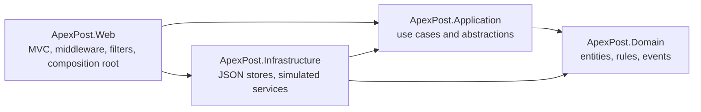
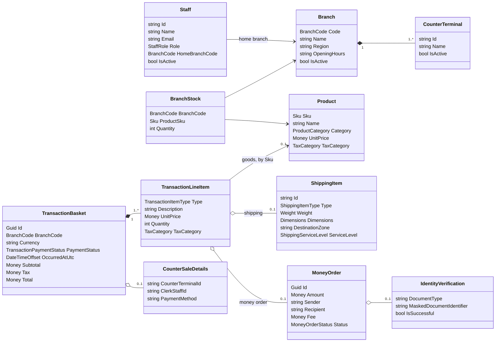
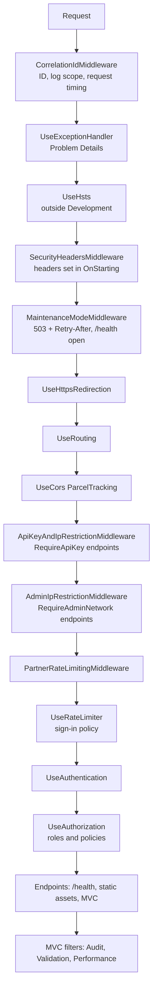

# ApexPost Counter Platform — Design

This document describes the platform as implemented on the `feature/void-refund-restock` branch. Where something is planned but not built, it says so. Decisions are recorded as ADRs in [docs/adr/](docs/adr/); a short request-flow walkthrough is in [docs/architecture.md](docs/architecture.md).

## 1. Architecture

### Layers

| Project | Responsibility | Depends on |
|---|---|---|
| `ApexPost.Domain` | Entities, value objects, business rules, domain services, events, specifications and report calculations. No I/O. | — |
| `ApexPost.Application` | Use cases (application services), persistence/security/audit/courier/verification abstractions, the domain-event publisher, the reference-data cache and request validation. | Domain |
| `ApexPost.Infrastructure` | JSON snapshot repository, JSON credential store, JSON Lines audit store, demo seed, and the simulated courier and identity-verification services. | Application, Domain |
| `ApexPost.Web` | MVC controllers and views, middleware, filters, authentication, authorization policies, the partner API and the composition root (`Program.cs`). | Application, Infrastructure |

Dependencies point inward. Application owns the interfaces (`IApexPostRepository`, `IStaffCredentialRepository`, `IAuditStore`, `ICourierTrackingService`, `IIdentityVerificationService`); Infrastructure implements them; Web wires them together. Controllers translate HTTP to application calls and back. They hold no business rules, and `Program.cs` only reads configuration, registers services and builds the pipeline.

**Did the Week 1 architecture survive?** This repository starts at the ApexPost solution (first commit: "initialize ApexPost solution structure"), so the Week 1 TechNova code is not in its history. The four-layer split shown above was chosen for ApexPost from the start, with the domain rebuilt around branches, counters, a mixed basket and postal/financial services. *Author to confirm against the Week 1 submission.*

### Domain model

- **Entities** have identity and a lifecycle: `Branch`, `Staff`, `Product`, `BranchStock`, `TransactionBasket`, `TransactionLineItem`, `ShippingItem`, `MoneyOrder`.
- **Value objects** are immutable `sealed record`s that validate on construction: `Money`, `Sku`, `BranchCode`, `Weight`, `Dimensions`, `ShippingRate`, `IdentityVerification` (holds only the masked identifier), and `CounterSaleDetails`.
- **The mixed basket uses composition, not inheritance.** A basket holds `TransactionLineItem`s, each with a `TransactionItemType` (`Goods`, `Service`, `MoneyOrder`) and at most one attached shipping item or money order. Rules that differ by line type are `switch` expressions on that type, for example money-order lines carry no tax. This keeps one totals calculation and one lifecycle for every kind of sale.
- **Basket lifecycle:** Open → Paid, Open → Voided, Paid → Voided, and Paid → Refunded. Voiding or refunding a paid sale returns its stock and cancels its money orders exactly once (`SaleReversalService`, [ADR 0011](docs/adr/0011-void-and-refund-of-completed-sales.md)).

### Pricing and tax

- **Shipping** uses `ShippingPricingService`, a rule object built from persisted `ShippingRate` records keyed by `(destination zone, service level)`. The price is `base price + weight in kg × per-kg charge`. A missing rate is an error, never a fallback ([ADR 0005](docs/adr/0005-configured-shipping-pricing-and-limits.md)). `ShippingWeightLimitRule` rejects parcels over the configured maximum for their service level; letters are exempt.
- **Tax** is a per-category rate dictionary (`Transactions:TaxRates:<TaxCategory>`) passed into the basket. Each line is taxed by its `TaxCategory`. Shipping lines use `Shipping:TaxCategory`, and money-order principal is not taxed. The money-order fee is a separate line with `MoneyOrders:Fee:TaxCategory`.
- **No values in code.** No price, tax rate, weight limit, threshold or fee has a default. If one is missing, the affected workflow is disabled (or fails closed) rather than guessing.

## 2. Business rules

| Rule | Enforced by |
|---|---|
| Branch stock never goes negative; a sale fails if any line lacks stock (all lines are checked before any stock is deducted) | `SaleProcessingService`, `BranchStock` |
| Inactive staff cannot process; clerks and managers transact only at their home branch; the clerk on the sale must be the signed-in staff member | `TransactionProcessingRule` |
| A closed branch, or an inactive or unknown counter, cannot take transactions | `TransactionProcessingRule` |
| A money order above the configured threshold needs a successful identity verification in the same transaction, decided by the verification service, not the user | `MoneyOrderIdentityVerificationRule`, `MixedBasketApplicationService` |
| Parcels over the configured maximum for their service level are rejected | `ShippingWeightLimitRule` |
| Voids and refunds need an active Branch Manager of the same branch and a reason | `TransactionVoidRefundRule` |
| Full identity-document numbers are never stored; only the last four characters are kept | `IdentityVerification` |
| A transaction ID can be processed once; repeated submissions do not deduct stock twice | Repository `UpdateAsync` callback in the application services |

## 3. Reports, events and notifications

### Reports

| Report | Who | Notes |
|---|---|---|
| Daily branch sales (goods vs. services) | Branch Manager | Filters by business date using `OccurredAtUtc` (UTC) |
| Low stock per branch | Branch Manager | Threshold is `Reports:LowStockThreshold`; the page returns 503 until it is configured |
| Shipping volume by zone and service level | Auditor, Administrator | |
| Money orders and identity verifications per branch | Auditor, Administrator | Includes cancelled money orders |

Report filters are composable specifications (`PaidTransactionSpecification`, `TransactionAtBranchSpecification`, `TransactionOnBusinessDateSpecification`, `StockAtBranchSpecification`), combined with `And`/`Or`/`Not` and applied with the `Matching` extension member.

### Dashboard

`/` shows a branch dashboard for signed-in staff. `BranchDashboardApplicationService` starts the reference-data load and the courier lookups for recent shipments at the same time and awaits them with `Task.WhenAll`. Sales and stock panels are shown to Branch Managers only.

### Domain events and simulated notifications

| Event | Raised when |
|---|---|
| `TransactionCompletedEvent` | A sale is processed |
| `StockLowEvent` | A sale or adjustment takes a product from above the threshold to at or below it (crossing only, so no repeats) |
| `MoneyOrderIssuedEvent` | A money order is issued |
| `HighValueMoneyOrderIssuedEvent` | The issued order is above the threshold |
| `TransactionVoidedEvent` | A sale is voided |
| `TransactionRefundedEvent` | A sale is refunded |

Events are collected inside the repository update and published by `DomainEventPublisher` only after the update has committed, so a rejected or rolled-back change never notifies anyone. `SimulatedNotificationSender` subscribes to the publisher's C# events and writes the four required notifications (low stock, high-value money order, void, refund) as structured warning logs prefixed `Simulated notification:`. A failing subscriber is logged and cannot undo the committed change ([ADR 0012](docs/adr/0012-committed-domain-events-and-simulated-notifications.md)).

## 4. Persistence

- **Store:** `JsonApexPostRepository` keeps one versioned `apexpost.json` snapshot in `Storage:Directory`. Infrastructure maps it through DTOs and rebuilds domain objects through their validating constructors; it never deserializes straight into entities.
- **Concurrency:** `UpdateAsync(Func<snapshot, snapshot>)` holds a `SemaphoreSlim` across load, change and save. It writes to a temporary file in the same folder and then moves it into place. If the callback throws, nothing is saved. This is what makes concurrent sales safe within one process ([ADR 0001](docs/adr/0001-json-snapshot-persistence.md), [ADR 0004](docs/adr/0004-atomic-transaction-processing.md)).
- **Schema migration:** the current schema is 7.

  | Version | Change |
  |---|---|
  | 2–4 | Transaction IDs, money-order verification links, basket branch and shipping-line links |
  | 5 | Transaction `OccurredAtUtc` |
  | 6 | Money-order `Id` and `Status`, and line-to-money-order links |
  | 7 | Sale details: counter, clerk and payment method |

  Older files are migrated on load without inventing business data; for example, undated legacy sales stay undated. A file without a version that contains newer fields is rejected.
- **Failure behaviour:** a missing file is an empty snapshot. A malformed, unsupported or domain-invalid file fails loudly and is never overwritten.
- **Other stores:** credentials live in a separate file (`Authentication:CredentialFile`, [ADR 0007](docs/adr/0007-separate-staff-credential-store.md)), and audit records are appended to a JSON Lines file (`Audit:FilePath`).
- **Next step:** a database can replace these stores behind the same interfaces. The lock is per process; it does not coordinate several processes sharing one folder.

## 5. HTTP pipeline

| Position | Why it is there |
|---|---|
| Correlation ID first | Every later log line, error response and audit record can carry the ID. It wraps everything, so its `try/finally` timing covers failed requests too. |
| Exception handler second | Catches anything downstream and returns Problem Details with a trace ID and no stack trace (no developer exception page is registered). It sits inside the correlation scope so errors are correlated. |
| HSTS, then security headers | Headers are added in `Response.OnStarting`, so they are present on every response, including errors, maintenance 503s and redirects. |
| Maintenance before routing | Shuts the app quickly without running authentication or MVC; `/health` stays reachable for monitors. |
| HTTPS redirection before routing | Plain-HTTP requests are redirected before any endpoint work. |
| Routing before CORS and endpoint checks | `[RequireApiKey]` and `[RequireAdminNetwork]` are endpoint metadata, which exists only after routing. CORS also needs the matched endpoint. |
| API key/IP, then admin IP, then partner limit | Cheap rejections happen before authentication. The partner limit counts only callers that have proven the key, so anonymous floods cannot use up a partner's quota. |
| Sign-in rate limiter before authentication | Brute-force attempts are refused before any password hashing work. |
| Authentication, then authorization | Claims must exist before policies (`BranchManagerOnly`, `SameBranchOnly`) are evaluated. |

## 6. Middleware versus filters

| Concern | Implemented as | Why |
|---|---|---|
| Correlation ID, request logging and timing | Middleware | Applies to every request, including static files, `/health` and errors that never reach MVC. |
| Exception handling | Built-in middleware | Must catch failures from anywhere in the pipeline. |
| Security headers, HTTPS, HSTS | Middleware | Response-wide, endpoint-independent. |
| Maintenance mode | Middleware | Must stop requests before routing, authentication or MVC. |
| API key, IP allowlists, rate limits | Middleware | Must reject before authentication and MVC run. It reads endpoint metadata after routing, so marking an endpoint is still per-action. |
| CORS | Built-in middleware | Preflight requests never reach an action. |
| Auditing | `AuditActionFilter` (global, `ServiceFilter`, opt-in through `[Audited]`) | Needs the selected controller, action and route values, plus the action's final result. Middleware sees only URLs. |
| Validation | `ValidationActionFilter` (global) | Needs bound `ModelState`, which exists only inside MVC. It redisplays MVC forms through the controller's `IInvalidModelStateHandler`, and returns `ValidationProblemDetails` for `[ApiController]` endpoints. |
| Action performance | `PerformanceActionFilter` (global) | Times only the action, separate from whole-request timing, and logs a warning above `Performance:SlowActionThresholdMilliseconds`. |
| Same-branch access | `SameBranchOnly` resource-based authorization policy | Needs the loaded transaction's branch, which is known only inside the action. |

## 7. Security

### Authentication and authorization

- **Sign-in:** cookie authentication with claims `StaffId`, `Role` and `BranchCode`. The cookie is HttpOnly, always Secure and SameSite=Lax, with an 8-hour sliding lifetime.
- **Revalidation:** every request rechecks the cookie against the current staff record (`StaffCookieAuthenticationEvents`), so deactivated or reassigned staff lose access immediately.
- **Passwords:** PBKDF2-SHA256 with at least 600,000 iterations and a random 16-byte salt, compared in constant time. A dummy hash runs for unknown staff IDs. Credentials are kept in a separate file from business data.
- **Policies:**
  - `BranchManagerOnly` (role) protects transaction history, voids, refunds, stock and manager reports. A Counter Clerk can open the details and shipping label of a sale they processed themselves, read-only (`TransactionAccessRule.CanView`).
  - `SameBranchOnly` (resource-based) compares the transaction's branch with the staff member's saved home branch, not the cookie claim ([ADR 0002](docs/adr/0002-authoritative-branch-scoped-transactions.md)).
  - Administration requires the Administrator role.
- **Forms:** antiforgery is required on every POST, and return URLs must be local.

### Partner and admin endpoints

- **Partner API:** `GET /integration/parcel-status/{shipmentId}` is marked `[RequireApiKey]`. The `X-API-Key` header is compared in constant time against a SHA-256 digest of `ApiSecurity:ApiKey`, which comes from user-secrets or the environment, never source.
  - 401 for a missing or wrong key, and 500 if no key is configured.
  - 403 from an IP outside `ApiSecurity:AllowedIpAddresses`.
  - 429 above `ApiSecurity:PartnerRateLimit`.
  - The response contains stored shipment facts, the existing transaction status and the simulated courier result. It has no prices, people or identity data ([ADR 0013](docs/adr/0013-partner-parcel-status-api-and-endpoint-security.md)).
- **Admin pages:** `[RequireAdminNetwork]` pages return 403 outside `AdminSecurity:AllowedIpAddresses`.
- **Empty allowlists:** an empty list switches that IP filter off; production must set both lists.

### Threats and mitigations

| Threat | Mitigation | Residual risk |
|---|---|---|
| Password guessing | Sign-in rate limit (429), PBKDF2, generic error message | Limit is per IP; shared NAT users share it |
| Account enumeration by timing | Dummy hash for unknown IDs, at the same 600,000 iterations that every created credential uses | A credential provisioned out of band with more iterations would still take longer than the dummy |
| Stolen or stale cookie | HttpOnly, Secure, SameSite cookie; per-request staff revalidation | Theft of a live cookie within its lifetime |
| CSRF | Antiforgery on every POST; SameSite=Lax | — |
| XSS and clickjacking | CSP `default-src 'self'` (no inline script), `X-Frame-Options: DENY`, `frame-ancestors 'none'`, nosniff, no-referrer | — |
| Cross-branch data access (IDOR) | Branch scoping from persisted staff in the services, plus `SameBranchOnly`; other branches' IDs return 404 or 403 | — |
| Partner key leakage or abuse | Key from secrets only; digest compare; IP allowlist; partner rate limit; minimal response | One shared key means one rate bucket for all partners |
| Spoofed client IP | `RemoteIpAddress` only; forwarded headers are not trusted | Behind a proxy, configure forwarded headers before relying on IP checks |
| CORS misuse | Exact configured origin, GET only, no credentials | CORS only tells browsers what to allow. It does not stop scripts or servers calling the API, so it is not a security boundary; the API key is. |
| Sensitive data in logs or audit | Audit records only IDs, roles, route keys and status; passwords, document numbers, keys and form values are never recorded; identity documents are masked in the domain | Void/refund notification logs include the staff-entered reason |
| Secrets in the repository | User-secrets (`UserSecretsId` set), `.gitignore` for data folders, demo password never committed | — |
| Lost updates under concurrency | Locked read-modify-write and atomic file replace | Single process only |
| Error detail disclosure | Problem Details with a trace ID only | — |

## 8. Auditing and privacy

- **What is audited:** actions marked `[Audited]`:
  - sign-in and sign-out
  - sales, including money orders and their identity checks, which happen inside the sale
  - voids, refunds and stock adjustments
  - all administration changes

  Page views, reports and partner lookups are not audited ([ADR 0009](docs/adr/0009-mvc-cross-cutting-filters.md)).
- **What a record holds:**
  - UTC time
  - controller and action
  - outcome: `Succeeded` below 400, `Rejected` for 4xx, `Failed` for 5xx or an exception
  - the status code actually sent: the filter writes after the result runs, so redirects are 302
  - duration and allow-listed route values (`id`, `transactionId`, `branchCode`); a new sale adds its posted transaction ID through `AuditActionFilter.AddAuditValue`, which accepts only the same allow-listed keys
  - staff ID, role and branch
  - correlation ID
- **Where it is stored:** `IAuditStore` is implemented by `JsonAuditStore`, an append-only JSON Lines file serialized by a `SemaphoreSlim`. A write is not cancelled if the client disconnects. [data/AUDIT-SAMPLE.json](data/AUDIT-SAMPLE.json) contains real lines from a local run.
- **Personal data:** no passwords, API keys, full document numbers, card data or form values are written. Route keys that look sensitive (password, key, token, secret, credential, document, card) are dropped.
- **Integrity:** the file is not tamper-evident; protect it with file permissions and backups.
- **Gaps:** requests rejected before MVC (authorization, antiforgery, rate limit, IP) are logged by the framework but not audited.

## 9. Asynchrony, concurrency and caching

| Technique | Where | Why |
|---|---|---|
| `async`/`await` with `CancellationToken` | Controllers → application services → repositories and simulated services | No blocking I/O; abandoned requests stop work. There is no `.Result`, `.Wait()` or `Thread.Sleep`. |
| `Task.WhenAll` | `BranchDashboardApplicationService` (reference data plus courier lookups); demo credential hashing | Independent work runs at the same time, so the page waits for the slowest call rather than the sum |
| `SemaphoreSlim` | JSON repository and audit store (one writer); simulated courier (`Courier:MaxConcurrentLookups`) | Safe file writes; bounded load on the external courier |
| `ValueTask` plus cache | `ReferenceDataCache` (products and shipping rates, `Caching:ReferenceDataSeconds` = 30), read by the dashboard and the catalogue page | A cache hit returns synchronously without reading and deserializing the JSON file. Sale pricing always uses the authoritative snapshot inside the locked update, never the cache. |
| Timeouts, separate from cancellation | Simulated courier and identity verification use `CancellationTokenSource(timeout, TimeProvider)` | A timeout becomes `TimedOut` or a 503 "verification unavailable"; caller cancellation propagates as cancellation. |

**Measurement:** no benchmark has been recorded yet. The cache's benefit is explained above rather than measured; adding a timing comparison is listed under known gaps.

**DI lifetimes:**
- **Singletons:** repository, credential and audit stores, cache, event publisher, notification sender, `TimeProvider`, simulated services. They hold locks or shared state.
- **Scoped:** application services, filters and `StaffCookieAuthenticationEvents`, which are per request.
- **Middleware** is created once, so its constructors take only singletons (`IConfiguration`, `ILogger`, the partner limiter). Nothing scoped is captured.

## 10. C# 14 and language features

| Feature | Where | Problem it solves |
|---|---|---|
| Records and value objects | `Money`, `Sku`, `BranchCode`, `Weight`, `Dimensions`, `ShippingRate`, `IdentityVerification`, `CounterSaleDetails` | Validated, immutable values with value equality |
| Pattern matching | Line tax by item type, basket status transitions, notification text, event dispatch | One readable rule per case |
| Extension members (`extension` blocks) | `SpecificationExtensions.Matching`, `ApexPostSnapshotExtensions.IsCompletelyEmpty` | Query helpers without changing the types |
| `field` keyword | `BranchStock.Quantity`, `MoneyOrder.Status`, `CounterSaleDetails` | Validation or locking in accessors without a hand-written backing field |
| Generics with constraints | `Specification<T> where T : class`, `RequestValidator.Validate<T>` | Reusable report filters and validation |
| Delegates (`Func`, `Predicate`, `Action`) | `UpdateAsync(Func<…>)`, `PredicateSpecification<T>`, `SaleReversalService` status callback, subscriber error callback | Caller-supplied behaviour inside a locked or validated operation |
| Events | `DomainEventPublisher` C# events | Observer-style notifications |
| Custom attributes with cached reflection | `NotBlank`, `GreaterThanZero`, `DefinedEnum` plus `RequestValidator` (`ConcurrentDictionary` cache); `[Audited]`, `[RequireApiKey]`, `[RequireAdminNetwork]` | Declarative rules without reflecting on every request |
| async, `Task.WhenAll`, `SemaphoreSlim`, `ValueTask`, timeouts | See section 9 | |

## 11. SOLID mapping

| Principle | Where it shows |
|---|---|
| Single responsibility | One rule class per business rule; pricing, sale processing and reversal are separate domain services; storage, audit and credentials are separate stores |
| Open/closed | New report filters are new specifications; new notification channels subscribe to the publisher; a database repository can replace JSON behind `IApexPostRepository` |
| Liskov substitution | Simulated courier and verification services are interchangeable with real ones behind their interfaces; tests substitute fakes for the repository and stores |
| Interface segregation | Credential reads (`IStaffCredentialRepository`) are separate from provisioning (`IStaffCredentialProvisioning`); `IAuditStore` has one method |
| Dependency inversion | Application depends on its own interfaces; Infrastructure implements them; Web composes them |

## 12. Configuration and demo

`appsettings.json` holds only non-secret operational settings. Business values (tax rates, payment methods, shipping tax category and weight limits, money-order threshold, fee and accepted documents, low-stock threshold) and secrets (partner API key, demo password) must be supplied through user-secrets or the environment; there are no defaults. Startup rejects partial or invalid settings.

`./scripts/run-demo.ps1` runs the opt-in demo seed with demo logins whose password comes from user-secrets ([ADR 0003](docs/adr/0003-opt-in-demo-data.md), [ADR 0010](docs/adr/0010-demo-logins-from-user-secrets.md)). The README lists the accounts and settings.

## 13. Testing

There are four xUnit projects: Domain (rules and value objects), Application (use cases), Infrastructure (JSON persistence, migration, concurrency, demo seed) and Web integration (`WebApplicationFactory`: security headers, API key and IP, rate limits, CORS, maintenance, authentication, filters and controllers).

Only the assignment's allowed libraries are used: xUnit, `Microsoft.AspNetCore.Mvc.Testing` and the Microsoft test SDK. Test doubles are hand-written (`FakeApexPostRepository`, a fixed `TimeProvider`, a fake identity-verification service), and every integration test host uses `ApexPostWebApplicationFactory`, which drops the developer's user-secrets so local settings cannot change results.

| Project | Result | Main coverage |
|---|---|---|
| Domain | 213/213 | Stock, weight-limit, money-order verification and void/refund rules, pricing, transaction access (`CanView`) |
| Application | 110/110 | Multi-line counter sales, payment-method configuration, money orders as basket lines (fee, threshold, verification success, failure and timeout), dated reports, catalogue, clerk read access, password hashing and the dummy-hash timing |
| Infrastructure | 33/33 | JSON persistence, migration from each schema version 1–6 to 7, rejection of fields newer than the file's version, concurrency, demo seed |
| Web | 193/193 | The six required checks (security headers, partner 401 and 403, sign-in 429, sign-in redirect, clerk 403 on void, correlation ID), the access-denied page answering 403, audit opt-in, status codes and transaction ID, catalogue, label preview and its print wiring, clerk sale flow, partner parcel-status API and CORS, invalid startup configuration |

The dummy-hash timing test compares the fastest of three runs and accepts a ratio of 0.6–1.6 against a real check; the old 210,000-iteration dummy measured about 0.35.

## 14. Known gaps

- **Shipping label content:** the label preview prints only what a sale records (shipment ID, zone, service level, weight, dimensions, origin branch, date). The domain holds no sender or recipient address and no barcode format is specified, so neither is printed.
- **Browser-only behaviour:** the label's print button is wired in `site.js` (the CSP blocks inline handlers). Tests check that wiring (the button's hook, the script served from the site's origin, the `window.print()` binding), but no browser engine is allowed, so the click itself is not exercised. A forbidden browser request redirects to `/Account/AccessDenied`, which answers 403.
- **Single-process persistence:** the persistence lock and partner rate limiting are single-process, and there is one shared partner key.
- **Audit gaps:** the audit omits pre-MVC rejections (authorization, antiforgery, rate limit, IP checks); the framework logs them instead.
- **No measurements:** none are recorded for the cache or dashboard.

## 15. Decision records

| ADR | Decision |
|---|---|
| [0001](docs/adr/0001-json-snapshot-persistence.md) | Versioned JSON snapshot persistence |
| [0002](docs/adr/0002-authoritative-branch-scoped-transactions.md) | Branch scope from persisted staff |
| [0003](docs/adr/0003-opt-in-demo-data.md) | Opt-in idempotent demo data |
| [0004](docs/adr/0004-atomic-transaction-processing.md) | Atomic transaction processing |
| [0005](docs/adr/0005-configured-shipping-pricing-and-limits.md) | Configured shipping pricing and limits |
| [0006](docs/adr/0006-money-order-verification-and-privacy.md) | Money orders as basket lines with system verification |
| [0007](docs/adr/0007-separate-staff-credential-store.md) | Separate staff credential store |
| [0008](docs/adr/0008-http-security-pipeline-order.md) | HTTP pipeline order |
| [0009](docs/adr/0009-mvc-cross-cutting-filters.md) | MVC filters: opt-in audit, validation, performance |
| [0010](docs/adr/0010-demo-logins-from-user-secrets.md) | Demo logins from user-secrets |
| [0011](docs/adr/0011-void-and-refund-of-completed-sales.md) | Void and refund of completed sales |
| [0012](docs/adr/0012-committed-domain-events-and-simulated-notifications.md) | Committed-only domain events and notifications |
| [0013](docs/adr/0013-partner-parcel-status-api-and-endpoint-security.md) | Partner parcel-status API and endpoint security |
| [0014](docs/adr/0014-transaction-dates-and-sale-details.md) | Transaction dates and sale details |
| [0015](docs/adr/0015-caching-concurrency-and-timeouts.md) | Caching, concurrency and timeouts |
