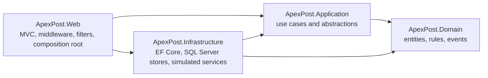
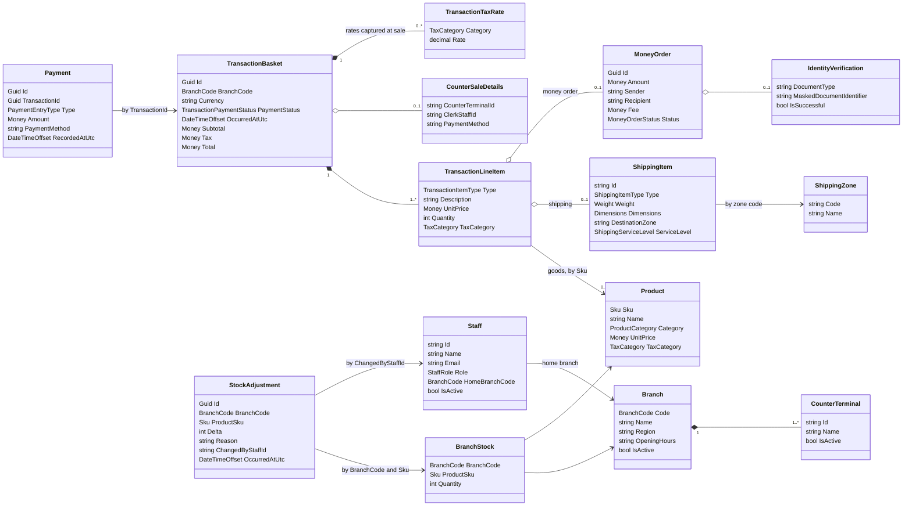
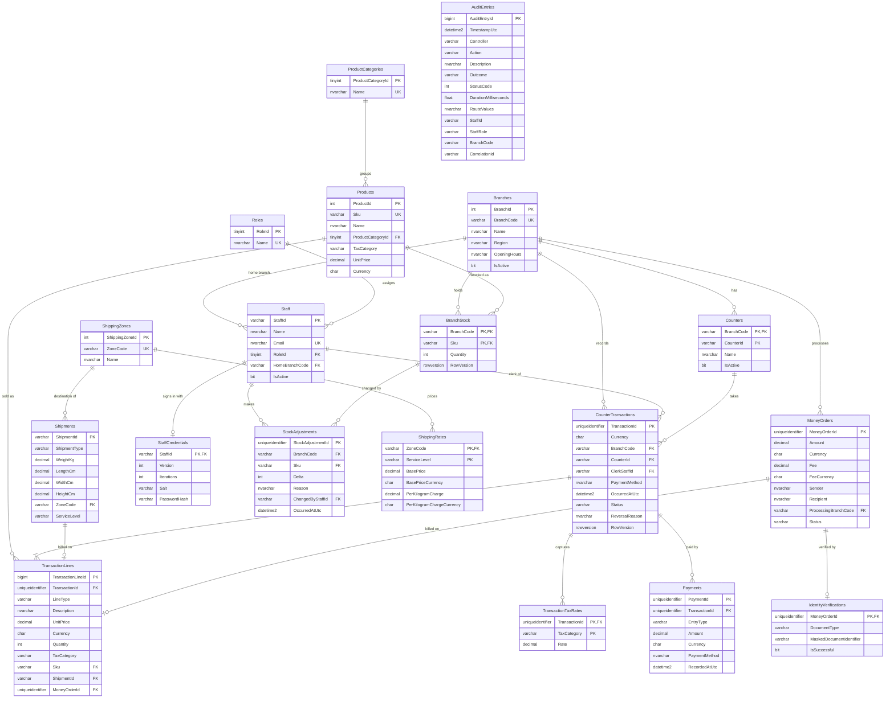
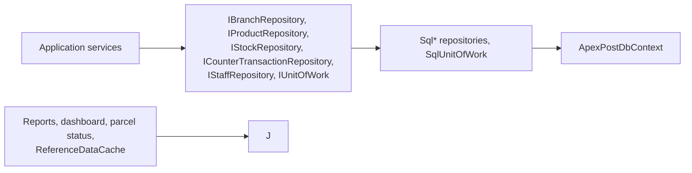
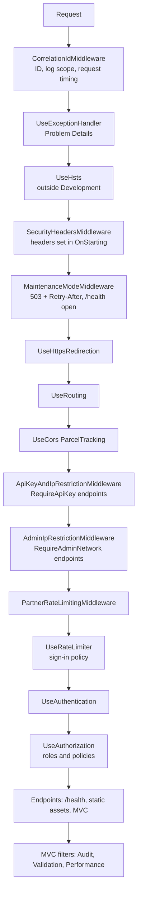

# ApexPost Counter Platform — Design

This document describes the platform as implemented on the `feature/week3-sql-persistence` branch. Where something is planned but not built, it says so. Decisions are recorded as ADRs in [docs/adr/](docs/adr/); a short request-flow walkthrough is in [docs/architecture.md](docs/architecture.md). **The application runs on SQL Server** since Week 3 M3 ([section 4.6](#46-sql-server-cutover)). The schema is in [section 4.4](#44-sql-server-schema), and the repositories in [section 4.5](#45-repositories-and-unit-of-work).

## 1. Architecture

### Layers

| Project | Responsibility | Depends on |
|---|---|---|
| `ApexPost.Domain` | Entities, value objects, business rules, domain services, events, specifications and report calculations. No I/O. | — |
| `ApexPost.Application` | Use cases (application services), persistence/security/audit/courier/verification abstractions, the domain-event publisher, the reference-data cache and request validation. | Domain |
| `ApexPost.Infrastructure` | `ApexPostDbContext`, EF Core mappings and migrations, SQL Server repositories and stores, demo seed, and the simulated courier and identity-verification services. The older JSON stores remain in the code but the application no longer uses them. | Application, Domain |
| `ApexPost.Web` | MVC controllers and views, middleware, filters, authentication, authorization policies, the partner API and the composition root (`Program.cs`). | Application, Infrastructure |

Dependencies point inward. Application owns the interfaces (`IBranchRepository`, `IProductRepository`, `IStockRepository`, `ICounterTransactionRepository`, `IStaffRepository`, `IUnitOfWork`, `ICurrentStaffAccessor`, `IApexPostRepository`, `IStaffCredentialRepository`, `IAuditStore`, `ICourierTrackingService`, `IIdentityVerificationService`); Infrastructure implements them, except that the temporary `SnapshotStore` in Application implements the repository and unit-of-work interfaces over `IApexPostRepository` until M3 ([section 4.5](#45-repositories-and-unit-of-work)); Web wires them together. Controllers translate HTTP to application calls and back. They hold no business rules, and `Program.cs` only reads configuration, registers services and builds the pipeline.

**Did the Week 1 architecture survive?** This repository starts at the ApexPost solution (first commit: "initialize ApexPost solution structure"), so the Week 1 TechNova code is not in its history. The four-layer split shown above was chosen for ApexPost from the start, with the domain rebuilt around branches, counters, a mixed basket and postal/financial services. *Author to confirm against the Week 1 submission.*

### Domain model

- **Entities** have identity and a lifecycle: `Branch`, `Staff`, `Product`, `BranchStock`, `TransactionBasket`, `TransactionLineItem`, `ShippingItem`, `MoneyOrder`, `Payment`, `ShippingZone`, `StockAdjustment`.
- **Value objects** are immutable `sealed record`s that validate on construction: `Money`, `Sku`, `BranchCode`, `Weight`, `Dimensions`, `ShippingRate`, `IdentityVerification` (holds only the masked identifier), `CounterSaleDetails`, and `TransactionTaxRate`.
- **References by ID:** `Payment` and `StockAdjustment` hold IDs and codes, not object references. `ShippingItem` and `ShippingRate` refer to a `ShippingZone` by its code in `DestinationZone`. The database enforces these links with foreign keys. No application service creates `Payment` or `StockAdjustment` objects yet; that starts in M2.
- **The mixed basket uses composition, not inheritance.** A basket holds `TransactionLineItem`s, each with a `TransactionItemType` (`Goods`, `Service`, `MoneyOrder`) and at most one attached shipping item or money order. Rules that differ by line type are `switch` expressions on that type, for example money-order lines carry no tax. This keeps one totals calculation and one lifecycle for every kind of sale.
- **Basket lifecycle:** Open → Paid, Open → Voided, Paid → Voided, and Paid → Refunded. Voiding or refunding a paid sale returns its stock and cancels its money orders exactly once (`SaleReversalService`, [ADR 0011](docs/adr/0011-void-and-refund-of-completed-sales.md)).

### Pricing and tax

- **Shipping** uses `ShippingPricingService`, a rule object built from persisted `ShippingRate` records keyed by `(destination zone, service level)`. The price is `base price + weight in kg × per-kg charge`. A missing rate is an error, never a fallback ([ADR 0005](docs/adr/0005-configured-shipping-pricing-and-limits.md)). `ShippingWeightLimitRule` rejects parcels over the configured maximum for their service level; letters are exempt.
- **Tax** is a per-category rate dictionary (`Transactions:TaxRates:<TaxCategory>`) passed into the basket. Each line is taxed by its `TaxCategory`. Shipping lines use `Shipping:TaxCategory`, and money-order principal is not taxed. The money-order fee is a separate line with `MoneyOrders:Fee:TaxCategory`.
- **No values in code.** No price, tax rate, weight limit, threshold or fee has a default. If one is missing, the affected workflow is disabled (or fails closed) rather than guessing.

## 2. Business rules

| Rule | Enforced by |
|---|---|
| Branch stock never goes negative; a sale fails if any line lacks stock (all lines are checked before any stock is deducted) | `SaleProcessingService`, `BranchStock` |
| Inactive staff cannot process; clerks and managers transact only at their home branch; the clerk on the sale must be the signed-in staff member | `TransactionProcessingRule` |
| A closed branch, or an inactive or unknown counter, cannot take transactions | `TransactionProcessingRule` |
| A money order above the configured threshold needs a successful identity verification in the same transaction, decided by the verification service, not the user | `MoneyOrderIdentityVerificationRule`, `MixedBasketApplicationService` |
| Parcels over the configured maximum for their service level are rejected | `ShippingWeightLimitRule` |
| Voids and refunds need an active Branch Manager of the same branch and a reason | `TransactionVoidRefundRule` |
| Full identity-document numbers are never stored; only the last four characters are kept | `IdentityVerification` |
| A transaction ID can be processed once; repeated submissions do not deduct stock twice | `ICounterTransactionRepository.ExistsAsync` inside `IUnitOfWork.ExecuteInTransactionAsync`; on SQL Server the primary key also enforces it |

## 3. Reports, events and notifications

### Reports

| Report | Who | Notes |
|---|---|---|
| Daily branch sales (goods vs. services) | Branch Manager | Filters by business date using `OccurredAtUtc` (UTC) |
| Low stock per branch | Branch Manager | Threshold is `Reports:LowStockThreshold`; the page returns 503 until it is configured |
| Shipping volume by zone and service level | Auditor, Administrator | |
| Money orders and identity verifications per branch | Auditor, Administrator | Includes cancelled money orders |

Report filters are composable specifications (`PaidTransactionSpecification`, `TransactionAtBranchSpecification`, `TransactionOnBusinessDateSpecification`, `StockAtBranchSpecification`), combined with `And`/`Or`/`Not` and applied with the `Matching` extension member.

### Dashboard

`/` shows a branch dashboard for signed-in staff. `BranchDashboardApplicationService` starts the reference-data load and the courier lookups for recent shipments at the same time and awaits them with `Task.WhenAll`. Sales and stock panels are shown to Branch Managers only.

### Domain events and simulated notifications

| Event | Raised when |
|---|---|
| `TransactionCompletedEvent` | A sale is processed |
| `StockLowEvent` | A sale or adjustment takes a product from above the threshold to at or below it (crossing only, so no repeats) |
| `MoneyOrderIssuedEvent` | A money order is issued |
| `HighValueMoneyOrderIssuedEvent` | The issued order is above the threshold |
| `TransactionVoidedEvent` | A sale is voided |
| `TransactionRefundedEvent` | A sale is refunded |

Events are collected inside `IUnitOfWork.ExecuteInTransactionAsync` and published by `DomainEventPublisher` only after it has committed, so a rejected or rolled-back change never notifies anyone. `SimulatedNotificationSender` subscribes to the publisher's C# events and writes the four required notifications (low stock, high-value money order, void, refund) as structured warning logs prefixed `Simulated notification:`. A failing subscriber is logged and cannot undo the committed change ([ADR 0012](docs/adr/0012-committed-domain-events-and-simulated-notifications.md)).

## 4. Persistence

> **Historical.** The bullets below up to section 4.4 describe the JSON store used until Week 3 M3. The application no longer uses it. The classes remain only because existing Infrastructure tests still compile against them.

- **Store:** `JsonApexPostRepository` keeps one versioned `apexpost.json` snapshot in `Storage:Directory`. Infrastructure maps it through DTOs and rebuilds domain objects through their validating constructors; it never deserializes straight into entities.
- **Concurrency:** `UpdateAsync(Func<snapshot, snapshot>)` held a `SemaphoreSlim` across load, change and save, and the repository wrote to a temporary file before moving it into place ([ADR 0001](docs/adr/0001-json-snapshot-persistence.md), [ADR 0004](docs/adr/0004-atomic-transaction-processing.md)). SQL Server concurrency is in [ADR 0021](docs/adr/0021-concurrency-strategy.md).
- **Schema migration:** the current schema is 7.

  | Version | Change |
  |---|---|
  | 2–4 | Transaction IDs, money-order verification links, basket branch and shipping-line links |
  | 5 | Transaction `OccurredAtUtc` |
  | 6 | Money-order `Id` and `Status`, and line-to-money-order links |
  | 7 | Sale details: counter, clerk and payment method |

  Older files are migrated on load without inventing business data; for example, undated legacy sales stay undated. A file without a version that contains newer fields is rejected.
- **Failure behaviour:** a missing file is an empty snapshot. A malformed, unsupported or domain-invalid file fails loudly and is never overwritten.
- **Other stores:** credentials lived in a separate file ([ADR 0007](docs/adr/0007-separate-staff-credential-store.md)), and audit records in a JSON Lines file. Both are now tables.

### 4.4 SQL Server schema

Week 3 M1 added the schema and mapping, and M3 moved the application onto them. Decisions are in [ADR 0017](docs/adr/0017-money-precision-and-rounding.md) (money precision), [ADR 0018](docs/adr/0018-schema-design-and-delete-behaviours.md) (schema and deletes) and [ADR 0019](docs/adr/0019-domain-and-persistence-separation.md) (domain and persistence models).

#### ER diagram

Every table also has `CreatedAtUtc`, `CreatedBy` and `ModifiedAtUtc`, left out here for space.

The table count is 19: the 17 the brief lists, plus `TransactionTaxRates` and `StaffCredentials`.

#### Normalization note (3NF)

Every non-key column depends only on its table's key. Three concrete anomalies this design prevents:

| Anomaly | Without this design | How the schema prevents it |
|---|---|---|
| **Update** | If each sale copied the branch's name and region, renaming a region would mean updating every sale, and a missed row would leave reports disagreeing | Name and region exist once, in `Branches`. `CounterTransactions` holds only `BranchCode` |
| **Insertion** | If stock and product details shared a table, a product could not be added to the catalogue until a branch stocked it. If zones existed only as text on rates, a zone could not exist before its first rate, and a typo would create a new zone | `Products` is separate from `BranchStock`. `ShippingZones` is separate, and `ShippingRates` and `Shipments` must reference a real zone |
| **Deletion** | If product details lived only on transaction lines, losing the last line for a product would lose the product | `Products` stands alone, and `Restrict` stops a referenced product being deleted |

**Deliberate exceptions:**
- `TransactionLines.Description`, `UnitPrice` and `TaxCategory` are copied from the product at sale time. They are not redundant: they record what was charged then, and they must not change when a price changes.
- `TransactionLines.Currency` repeats the transaction's currency, because `Money` is stored as a whole value. The domain rejects a line in another currency (`TransactionBasket.AddLineItem`).
- `PaymentMethod` is on both `CounterTransactions` and `Payments`, recording different facts. The transaction column is the method selected for the sale; the payment column is the method used for that financial movement, so a refund can record how the money went back. For a normal sale the two match. Neither is edited after it is written ([ADR 0018](docs/adr/0018-schema-design-and-delete-behaviours.md)).

#### Mapping reference

Code: `src/ApexPost.Infrastructure/Persistence/Sql/`.

| Concern | Implementation |
|---|---|
| DbContext | `ApexPostDbContext`, scoped use from M2; the configurations are applied with `ApplyConfigurationsFromAssembly` |
| Design-time creation | `ApexPostDbContextFactory`: holds no connection string, so generating a migration or script never reads secrets or touches a database |
| Fluent configuration | `Configurations/`: one `IEntityTypeConfiguration` class per entity, 18 in all. The 19th table, `TransactionTaxRates`, is an owned collection configured inside `CounterTransactionConfiguration` |
| Shared column rules | `MappingExtensions`: `IsBranchCode`, `IsSku`, `IsCode`, `IsEnumCode`, `IsMoney`, `IsUtcDateTime`, `IsActiveFlag`, `HasAuditColumns` |
| Value converters | `ValueConverters.cs`: `BranchCodeConverter`, `SkuConverter`, `WeightConverter`, `MoneyAmountConverter`, `UtcDateTimeOffsetConverter`, `RouteValuesConverter` |
| Complex types | `Money` (two columns, so a converter handles its amount and the type maps as a complex property, safely shared between objects) and `Dimensions` |
| Owned types | `CounterSaleDetails` (optional, stored on `CounterTransactions`) and `TransactionTaxRate` (owned collection, stored in `TransactionTaxRates`) |
| Shadow properties | `RowVersion`; `CreatedAtUtc`, `CreatedBy`, `ModifiedAtUtc`; surrogate keys such as `BranchId`; foreign keys such as `TransactionId` on lines |
| Backing fields | `_lineItems`, `_counterTerminals`, `_taxRates`, `_reversalReason`, `_branchCode`, `_paymentStatus` |
| Separate persistence model | `IdentityVerificationRecord` and `IdentityVerificationMapper` |
| `varchar` codes | `IsUnicode(false)` with a maximum length on every code column. Verified: EF sends `@sku varchar(30)`, so an indexed code column is not compared through an implicit conversion |
| Health check | `SqlServerConnectivityHealthCheck` uses `Database.CanConnectAsync`, is mapped only in Development, and connects only when `/health/database` is requested |

`Address` on `Branch` was not added: the brief offers it as an example, nothing in ApexPost records one, and `Dimensions` and `CounterSaleDetails` already cover "complex and owned types where they fit".

#### Constraints

| Type | Count | Examples |
|---|---|---|
| UNIQUE | 6 | `UQ_Branches_BranchCode`, `UQ_Products_Sku`, `UQ_Staff_Email`, `UQ_ShippingZones_ZoneCode`, `UQ_Roles_Name`, `UQ_ProductCategories_Name` |
| CHECK | 33 | `CK_BranchStock_Quantity` (≥ 0), `CK_MoneyOrders_Amount` and `CK_Payments_Amount` (> 0), `CK_Shipments_Weight` (> 0), `CK_CounterTransactions_Status`, `CK_IdentityVerifications_MaskedDocumentIdentifier` |
| DEFAULT | 43 | Three audit defaults per table (`SYSUTCDATETIME()`, `SUSER_SNAME()`) are the main group, plus `IsActive`, `Quantity` and `Status` |
| Foreign key | 22 | 21 `NO ACTION`, 1 `CASCADE`; see [ADR 0018](docs/adr/0018-schema-design-and-delete-behaviours.md) |
| Rowversion | 2 | `BranchStock.RowVersion`, `CounterTransactions.RowVersion`, both `NOT NULL` |

Identity documents are stored only as `****` plus the last four characters, in `varchar(8)` with a CHECK that also rejects any other format. The domain's `IdentityVerification` masks first, so a full number never reaches the mapper.

#### Migrations

| Item | Location |
|---|---|
| Migration | `src/ApexPost.Infrastructure/Persistence/Sql/Migrations/20261031085407_InitialCreate.cs` |
| Idempotent script | `sql/schema/ApexPostDb-idempotent.sql` |
| Follow-up migration | `AddPerformanceIndexes`, planned for M6 |

The application never calls `EnsureCreated()` or migrates at startup. `InitialCreate` was reviewed by hand. The review made `CreatedBy`, `RowVersion` and `TransactionLines.TransactionId` non-nullable, and added the composite counter foreign key by hand.

**`ApexPostDb` itself has not been migrated.** It is still empty; verification used a separate disposable database.

#### M1 traceability

Verification ran on 2026-10-31 on SQL Server 2025 (17.0) Enterprise Evaluation, in a disposable database in `E:\SqlData\ApexPost\Tests`, since dropped. The EF round-trip checks were a throwaway probe, not repository tests; automated tests follow in the approved testing phase.

| Assignment requirement | Implementation | Documentation | Verification evidence |
|---|---|---|---|
| Part A: required tables | `Configurations/*.cs` | ER diagram above | 19 user tables after applying the script |
| A: PKs, FKs, delete behaviour | `Configurations/*.cs`; hand-written FK in `InitialCreate` | ADR 0018 | 22 FKs. Deleting a referenced branch and product was rejected. A counter from another branch was rejected |
| A: UNIQUE constraints | `HasAlternateKey` in `BranchConfiguration`, `ProductConfiguration`, `StaffConfiguration` | Constraints table | Duplicate `BranchCode`, `Sku` and email each rejected |
| A: CHECK constraints | `HasCheckConstraint` in each configuration | Constraints table | Negative stock, invalid status, zero amount, zero weight, unmasked document and a reason on a paid sale each rejected |
| A: DEFAULT and audit columns | `MappingExtensions.HasAuditColumns`, `IsActiveFlag` | Constraints table | Every table has all three audit columns; 43 defaults |
| A: rowversion | `BranchStockConfiguration`, `CounterTransactionConfiguration` | Constraints table | Both `NOT NULL`. Two contexts selling the same stock: the second got `DbUpdateConcurrencyException`, and stock stayed at 0 |
| A: data types | `MappingExtensions` | Mapping reference, ADR 0017 | Catalog query: 70 `varchar`/`char` columns, money `decimal(18,2)`; the 19 `nvarchar` columns are all names or free text, counted from `InitialCreate` after `Payments.PaymentMethod` was added |
| A: masked documents | `IdentityVerification`, `IdentityVerificationMapper`, `IdentityVerificationConfiguration` | ADR 0019 | `ABCDEFGH1234` stored as `****1234`; an unmasked value and an over-long value were rejected |
| A: ER diagram, three anomalies | This section | This section | Review |
| A: idempotent script | `sql/schema/ApexPostDb-idempotent.sql` | Migrations table | Applied twice to one database: both runs exited 0, and one history row was recorded |
| E: `ApexPostDbContext` | `ApexPostDbContext.cs` | Mapping reference | Round trip of a sale with goods, shipping and money-order lines |
| E: Fluent configuration per entity | `Configurations/*.cs` | Mapping reference | `has-pending-model-changes` reports no changes |
| E: value converters | `ValueConverters.cs` | Mapping reference, ADR 0017 | `BranchCode`, `Sku`, `Weight` and UTC times round-tripped; 11.255 stored as 11.26 |
| E: owned and complex types | `TransactionConfigurations.cs`, `ShippingConfigurations.cs` | Mapping reference | `CounterSaleDetails`, tax rates, `Money` and `Dimensions` round-tripped; null sale details stayed null |
| E: `InitialCreate` | `Migrations/20261031085407_InitialCreate.cs` | Migrations table | Applied by script and by `dotnet ef database update`; reverted to 0 tables and re-applied to 19 |
| A: `Payments` with its payment method | `Payment.cs`, `PaymentConfiguration` in `TransactionConfigurations.cs` | Normalization note, ADR 0018 | `Payments.PaymentMethod` is `nvarchar(50) NOT NULL`, and a NULL insert was rejected. `CounterTransactions.PaymentMethod` stays `nvarchar(50) NULL`. A sale selected `Card` while its refund entry recorded `Cash`, and both round-tripped |
| E: never `EnsureCreated()` | No call in `src` | Migrations table | `grep` of `src` found no `EnsureCreated` or `Migrate` call |
| F: rich entities, shadow properties | Domain entities; `HasAuditColumns`, `RowVersion` | ADR 0019 | Round trip through private constructors and backing fields |
| F: separate persistence entity and mapper | `IdentityVerificationRecord.cs` | ADR 0019 | Mapper round trip to `IdentityVerification.FromMaskedIdentifier` |
| Plan: `varchar` with `IsUnicode(false)` | `MappingExtensions.IsCode`, `IsBranchCode`, `IsSku`, `IsEnumCode` | Mapping reference | `ToQueryString()` shows `DECLARE @sku varchar(30)` |
| Plan: health check through EF Core | `SqlServerConnectivityHealthCheck.cs` | Mapping reference, README | `/health/database` returned `200 Healthy`; the existing health check tests passed |
| Week 2 rules preserved | Domain changes in ADR 0019 | ADR 0019 | All 558 existing tests passed after the `Payments.PaymentMethod` correction: Domain 213, Application 110, Infrastructure 38, Web 197. No test file was modified. These tests verify existing behaviour on JSON persistence, not the new SQL persistence. SQL schema and mapping were verified separately with throwaway probes on disposable databases, which are not repeatable automated tests |

**Not implemented in M1:** repositories and the Unit of Work, stamping of `ModifiedAtUtc` and the real `CreatedBy`, seed data, and automated SQL tests. Those belong to later milestones.

### 4.5 Repositories and Unit of Work

Week 3 M2 moved the application services onto repository and unit-of-work interfaces, and M3 removed the temporary `SnapshotStore` bridge that kept them on JSON in between. Decisions are in [ADR 0020](docs/adr/0020-repository-and-unit-of-work-boundaries.md) and [ADR 0021](docs/adr/0021-concurrency-strategy.md).

| Concern | Implementation |
|---|---|
| Interfaces | `src/ApexPost.Application/Persistence/` |
| SQL implementations | `src/ApexPost.Infrastructure/Persistence/Sql/SqlRepositories.cs`, `SqlUnitOfWork.cs` |
| Registration, all scoped | `SqlPersistenceRegistration.AddApexPostSqlPersistence` |
| Commit and retry | `IUnitOfWork.ExecuteInTransactionAsync` |
| Audit stamping | `AuditColumnsInterceptor`, `ICurrentStaffAccessor` |
| Input limits | `InputLimits`, `[MaximumLength]`: text lengths, and the largest value each decimal column holds |
| Failed use case | `SqlUnitOfWork` clears the change tracker, so nothing from a failed attempt reaches a later read |
| Set-based price revision | `SqlProductRepository.RevisePricesAsync` (`ExecuteUpdateAsync`), `AdministrationApplicationService.RevisePricesAsync`. No screen calls it yet |
| Input → command → entity | Web view models → `CounterBasketRequest` records → domain entities, mapped explicitly in the controllers and services. The sale form's posted fields include no status or audit values, and its posted `TransactionId` is the idempotency key. Automated over-posting tests are still to come |

**Behaviour changes from M2:**
- Text longer than its column, and numbers too large for theirs, are now rejected as validation errors.
- `AdjustStockAsync` records a fixed reason, "Manual stock adjustment", on the history row, because the screen does not ask for one.
- A refund, and a void of a paid sale, each write a `Refund` entry on SQL Server only. **These entries are inferred, not required by the brief, and are pending trainer confirmation** ([ADR 0020](docs/adr/0020-repository-and-unit-of-work-boundaries.md)).

#### M2 traceability

Verification first ran on 2026-10-31 on a disposable database, using throwaway probes that ran the real services. The M3 testing phase replaced those with the repeatable tests in `tests/ApexPost.Infrastructure.Tests/Sql/SqlPersistenceTests.cs`.

| Assignment requirement | Implementation | Documentation | Verification evidence |
|---|---|---|---|
| F: dependency direction | Interfaces in Application, implementations in Infrastructure | ADR 0020, diagram above | Domain and Application reference no EF Core packages |
| F: specific repositories | `IBranchRepository`, `IProductRepository`, `IStockRepository`, `ICounterTransactionRepository`, `IStaffRepository` | ADR 0020 | Sale, void, refund, stock adjustment and administration ran on them on SQL Server |
| F: stage only, no `IQueryable` | `SqlRepositories.cs` | ADR 0020 | Review of `SqlRepositories.cs`: public methods return entities or lists. `RevisePricesAsync` is the documented exception |
| F: `IUnitOfWork`, one commit per use case | `SqlUnitOfWork`, migrated services | ADR 0020 | A failed sale left no transaction, payment, money-order or stock change |
| F: scoped lifetimes | `AddApexPostSqlPersistence` | ADR 0020 | The probe resolved one scope per use case |
| F: persistence entity and mapper | `SqlCounterTransactionRepository`, `MoneyOrder.RestoreIdentityVerification` | ADR 0019, ADR 0020 | Basket and money-order reads returned the restored verification |
| F: Week 2 tests unchanged | `SnapshotStore` and the `IApexPostRepository` constructors, at M2 | ADR 0020 | At M2, all 558 existing tests passed with no test file changed, on JSON through the bridge. M3 removed the bridge, so see section 4.6 for the current test status |
| E: one `SaveChangesAsync` per sale | `MixedBasketApplicationService.ProcessAsync` | ADR 0020 | Sale saved transaction, lines, shipment, money order, verification, payment and stock together |
| E: `ExecuteUpdateAsync` | `SqlProductRepository.RevisePricesAsync` | ADR 0020 | 33.33 × 1.1 stored as 36.66; another category unchanged |
| E: concurrency | `SqlUnitOfWork`, rowversion | ADR 0021 | 20 sales of 10 units: 10 sold, stock 0. Retry reloaded state; repeated conflicts gave `ConcurrencyConflictException` |
| E: explicit transaction with execution strategy | `SqlUnitOfWork.ExecuteInTransactionAsync` | ADR 0021 | Ran with `EnableRetryOnFailure` configured. A transient failure was not simulated |
| Plan: events once | `committedEvents` in services | ADR 0021 | 10 completed events for 10 committed sales; no event for a failed sale |
| Implemented, pending trainer confirmation: void and refund entries | `TransactionApplicationService.RecordPaymentEntry` | ADR 0020, ADR 0017 | Void of a paid sale and a refund each added one `Refund` entry with the sale's method. Amounts matched on a sale without shipping (78.66). They were not compared on a sale with shipping, where ADR 0017 records a known defect |
| Plan: audit stamping | `AuditColumnsInterceptor` | ADR 0020 | `CreatedBy` and `ModifiedAtUtc` were stamped |
| Plan: input limits | `InputLimits` | ADR 0020 | A 501-character reason was rejected before saving |
| Numeric limits | `InputLimits.Ensure`, `MixedBasketApplicationService`, `AdministrationApplicationService` | ADR 0020 | Oversized weight rejected with no rows written |
| Failed use case clears tracked state | `SqlUnitOfWork.ExecuteInTransactionAsync` | ADR 0020 | No tracked entries after a failed attempt; tracked entries kept after a success |

**Not implemented in M2:** the report and dashboard query services. Tests for fakes, a spy Unit of Work and over-posting followed in the M3 testing phase.

### 4.6 SQL Server cutover

Week 3 M3 moved the Web application from JSON to SQL Server. `Program.cs` requires `ConnectionStrings:ApexPostDb` and registers `AddApexPostSqlPersistence`. `SnapshotStore` and the `IApexPostRepository` service constructors are gone, which also resolves the DI ambiguity on `StaffAuthenticationService`.

| Concern | Implementation |
|---|---|
| Reports, dashboard, parcel status | The Domain report classes are unchanged, and now read through repositories, calculating in memory. M5 replaces these with optimized query services |
| Added repository reads | `GetMoneyOrdersAsync`, `GetShipmentsAsync`, `FindByShipmentIdAsync` |
| `ReferenceDataCache` | Loads through `IReferenceDataSource`. `SqlReferenceDataSource` opens a short-lived scope, because the cache is a singleton |
| Audit | `SqlAuditStore`, in its own scope and commit ([ADR 0022](docs/adr/0022-audit-store-and-unit-of-work.md)) |
| Credentials | `SqlStaffCredentialRepository`, in `StaffCredentials` |
| Demo seed | `SqlDemoDataSeeder` writes `DemoDataInitializer`'s data in one commit: 5 branches, 20 staff, 30 products, 10 zones and rates, 210 paid sales with payments |
| Current staff | `HttpContextStaffAccessor` supplies `CreatedBy` |
| Problem Details | `ApplicationExceptionHandler` maps `ConcurrencyConflictException` and `DuplicateRecordException` to 409, `KeyNotFoundException` to 404 and `ArgumentException` to 400. Anything else stays a 500 |
| Unique violations | `SqlUnitOfWork` translates SQL errors 2601 and 2627 to `DuplicateRecordException` |

#### M3 traceability

Verified on 2026-10-31 by running the real application over HTTPS against a disposable seeded database in `E:\SqlData\ApexPost\Tests`, since dropped. That run was one-off. The repeatable equivalents are in [section 13](#13-testing). `ApexPostDb` itself has not been migrated.

| Assignment requirement | Implementation | Documentation | Verification evidence |
|---|---|---|---|
| G: screens read and write SQL Server | `Program.cs`, `AddApexPostSqlPersistence` | This section | 34 live checks passed across clerk, manager, auditor and administrator, with no errors logged |
| G: reports through services | The report application services | This section | Daily sales, low stock, shipping volume and branch auditor pages returned 200 |
| G: `AuditEntries` through `IAuditStore` | `SqlAuditStore`, `AuditActionFilter` | ADR 0022 | 9 audit rows, including the 409 rejections |
| G: exceptions to Problem Details | `ApplicationExceptionHandler` | This section | `ProblemDetailsExceptionHandlingTests.KnownException_MapsToItsProblemDetails` covers all four mappings |
| G: connection string from user-secrets | `Program.cs` | README | Startup refuses to run without it. The live run supplied it through the environment |
| E: seed volumes | `SqlDemoDataSeeder` | This section | 5 branches, 10 counters, 20 staff, 20 credentials, 30 products, 150 stock rows, 10 zones, 10 rates |
| E: 200+ historical transactions | `SqlDemoDataSeeder` | This section | 210 seeded sales, plus the 1 made in the run, with no negative stock |
| Plan: `CreatedBy` from the signed-in staff member | `HttpContextStaffAccessor` | This section | The sale recorded `demo-staff-01`, and the refund entry `demo-staff-02` |
| Plan: partner API | `ParcelStatusApplicationService` | This section | Status 200 for a real shipment, 404 for an unknown one |

**Test status after the M3 testing phase:** the whole solution builds with 0 warnings, and all 626 tests pass. See [section 13](#13-testing).

### 4.7 T-SQL reports, procedures and concurrency

M4 adds the hand-written T-SQL. It changes no screen: the application still uses the reads from M3, and M5 moves reports to query services or procedures.

| Folder | Contents |
|---|---|
| `sql/reports/` | The five reporting queries |
| `sql/transactions/atomic-sale.sql` | The atomic sale |
| `sql/procedures/` | The three stored procedures |
| `sql/demos/` | Fixture, blocking demo and deadlock demo. They refuse any database outside `ApexPost_Test_*` |
| `sql/security/least-privilege-role.sql` | The application's database role |

**Report definitions.** The daily sales, shipping volume, money-order and low-stock results follow the existing Domain reports. Tests compare `usp_DailyBranchSales`, `usp_LowStockReport` and the shipping and money-order queries with the application's own results, and check the other queries against expected values. A sale is a `Paid` transaction, and dates are UTC. Retail is `Goods` lines and services are `Service` lines, both with tax. Money-order principal counts as neither.

**Project decisions.** Week 3 does not specify the details below, so these are project decisions, not assignment or trainer requirements.

| Topic | Decision |
|---|---|
| Product revenue | Quantity × unit price before tax, across all paid sales (all-time), `Goods` lines only. Products are ranked separately by currency, because amounts in different currencies cannot be added. The daily sales totals include tax, so the two reports can show different amounts for the same sales |
| Top 10 | Each region and currency returns exactly 10 products when at least 10 have revenue, and all of them when fewer do. SKU is the deterministic tie-breaker, so a product tied for 10th place can be left out |
| `ROW_NUMBER()` and the CTE | Implementation choices that the trainer topics do not explicitly cover. `TOP (10)` alone cannot restart for each region, so `ROW_NUMBER()` numbers the products within each region and currency. The CTEs keep the aggregation and the ranking as separate, readable steps |
| Rounding | Following [ADR 0017](docs/adr/0017-money-precision-and-rounding.md), reports aggregate first, then round displayed totals to 2 decimals. Independently rounded totals may differ by 0.01. That includes `TotalSales` compared with `RetailSales + ServiceSales`: 10.004 + 10.004 displays as 10.00 and 10.00, with a total of 20.01 |

**How the design avoids deadlocks.** A deadlock needs two transactions taking the same locks in different orders.

- **Consistent table order.** A sale touches `BranchStock`, `CounterTransactions`, `Payments`, `TransactionLines`, then `TransactionTaxRates`. `EfSale_WritesTablesInTheDocumentedOrder` asserts this order for EF Core's real batch, and `atomic-sale.sql` follows it.
- **Consistent row order.** Stock rows are read in SKU order (`GetForProductsAsync`). `EfSave_UpdatesStockRowsInSkuOrderWhateverOrderTheyChanged` shows EF Core updates them in key order, even when they were changed in reverse.
- **Short transactions.** A sale reads, decides and writes in one short transaction. Identity verification, which is external, runs before it ([ADR 0021](docs/adr/0021-concurrency-strategy.md)), and nothing waits for a user.
- **One statement for `usp_AdjustStock`.** It locks a single stock row, then inserts one history row.
- **If one still happens.** A deadlock victim is a transient failure, which the execution strategy retries.

The set-based `UPDATE` in `atomic-sale.sql` does not guarantee a row order across several SKUs, so the row-order rule above is proven for the application, not that script.

#### M4 traceability

Evidence is saved in [docs/evidence/m4](docs/evidence/m4/README.md). Tests are in `tests/ApexPost.Infrastructure.Tests/Sql/SqlScriptTests.cs`.

| Assignment requirement | Implementation | Documentation | Verification evidence |
|---|---|---|---|
| B: daily sales, retail and services | `sql/reports/01-daily-branch-sales.sql` | This section | `DailySalesReportScript_SplitsRetailAndServices`; `reports.txt` |
| B: no sales today (LEFT JOIN) | `sql/reports/02-branches-with-no-sales-today.sql` | This section | `NoSalesTodayScript_ListsOnlyBranchesWithoutAPaidSaleToday` |
| B: top 10 products per region | `sql/reports/03-top-10-products-by-revenue-per-region.sql` | This section | `TopProductsScript_KeepsTheTopTenOfEachRegion`, with 12 products |
| B: shipping volume | `sql/reports/04-shipping-volume-by-zone-and-service-level.sql` | This section | `ShippingVolumeScript_MatchesTheApplicationReport` |
| B: money orders and verifications | `sql/reports/05-money-orders-and-identity-verifications-per-branch.sql` | This section | `MoneyOrderScript_MatchesTheApplicationReport` |
| B: atomic sale | `sql/transactions/atomic-sale.sql` | This section | `AtomicSaleScript_*`: commit, short stock, failure in the last insert; `atomic-sale.txt` |
| B: blocking demo and isolation level | `sql/demos/blocking-session-*.sql` | [Evidence guide](docs/evidence/m4/README.md) | `LCK_M_S`, about 18 s, READ COMMITTED |
| B: deadlock avoidance | This section | [ADR 0021](docs/adr/0021-concurrency-strategy.md) | Error 1205 with opposite order; both commit with the same order; two EF Core order tests |
| D: three procedures | `sql/procedures/` | [ADR 0023](docs/adr/0023-stored-procedures.md) | 18 `*Procedure_*` test methods; `procedures.txt` |
| D: compared with the application | `SqlStoredProcedures` | ADR 0023 | `DailySalesProcedure_MatchesTheApplicationReport`, `LowStockProcedure_MatchesTheApplicationReport` |
| D: transactional adjustment | `usp_AdjustStock` | ADR 0023 | `AdjustStockProcedure_RollsStockBackWhenTheHistoryRowFails`, `AdjustStockProcedure_StopsConcurrentCallsGoingBelowZero` |
| D: RECOMPILE choice | `usp_LowStockReport` | ADR 0023 | Seek for one branch, scan for `NULL` |
| D: parameterized calls | `SqlStoredProcedures` | ADR 0023 | `Database.SqlQuery` with `SqlParameter`; `LowStockProcedure_TreatsMaliciousInputAsAValue` |
| D: least privilege | `sql/security/least-privilege-role.sql` | ADR 0023 | `LeastPrivilegeRole_CanSellAndRunProceduresButCannotDeleteOrRewriteHistory` |
| D: ADR | [ADR 0023](docs/adr/0023-stored-procedures.md) | | Each reason avoids "faster" |
| E: follow-up migration | `20261031124843_AddStoredProcedures` | ADR 0023 | Applied by every SQL test; idempotent script applied twice (`schema.txt`); `Procedures_AreDeployedByTheMigrationFromTheRepositoryFiles` |

**Test status after M4:** the whole solution builds with 0 warnings, and all 662 tests pass: Domain 224, Application 120, Infrastructure 114, Web 204.

## 5. HTTP pipeline

| Position | Why it is there |
|---|---|
| Correlation ID first | Every later log line, error response and audit record can carry the ID. It wraps everything, so its `try/finally` timing covers failed requests too. |
| Exception handler second | Catches anything downstream and returns Problem Details with a trace ID and no stack trace (no developer exception page is registered). It sits inside the correlation scope so errors are correlated. |
| HSTS, then security headers | Headers are added in `Response.OnStarting`, so they are present on every response, including errors, maintenance 503s and redirects. |
| Maintenance before routing | Shuts the app quickly without running authentication or MVC; `/health` stays reachable for monitors. |
| HTTPS redirection before routing | Plain-HTTP requests are redirected before any endpoint work. |
| Routing before CORS and endpoint checks | `[RequireApiKey]` and `[RequireAdminNetwork]` are endpoint metadata, which exists only after routing. CORS also needs the matched endpoint. |
| API key/IP, then admin IP, then partner limit | Cheap rejections happen before authentication. The partner limit counts only callers that have proven the key, so anonymous floods cannot use up a partner's quota. |
| Sign-in rate limiter before authentication | Brute-force attempts are refused before any password hashing work. |
| Authentication, then authorization | Claims must exist before policies (`BranchManagerOnly`, `SameBranchOnly`) are evaluated. |

## 6. Middleware versus filters

| Concern | Implemented as | Why |
|---|---|---|
| Correlation ID, request logging and timing | Middleware | Applies to every request, including static files, `/health` and errors that never reach MVC. |
| Exception handling | Built-in middleware | Must catch failures from anywhere in the pipeline. |
| Security headers, HTTPS, HSTS | Middleware | Response-wide, endpoint-independent. |
| Maintenance mode | Middleware | Must stop requests before routing, authentication or MVC. |
| API key, IP allowlists, rate limits | Middleware | Must reject before authentication and MVC run. It reads endpoint metadata after routing, so marking an endpoint is still per-action. |
| CORS | Built-in middleware | Preflight requests never reach an action. |
| Auditing | `AuditActionFilter` (global, `ServiceFilter`, opt-in through `[Audited]`) | Needs the selected controller, action and route values, plus the action's final result. Middleware sees only URLs. |
| Validation | `ValidationActionFilter` (global) | Needs bound `ModelState`, which exists only inside MVC. It redisplays MVC forms through the controller's `IInvalidModelStateHandler`, and returns `ValidationProblemDetails` for `[ApiController]` endpoints. |
| Action performance | `PerformanceActionFilter` (global) | Times only the action, separate from whole-request timing, and logs a warning above `Performance:SlowActionThresholdMilliseconds`. |
| Same-branch access | `SameBranchOnly` resource-based authorization policy | Needs the loaded transaction's branch, which is known only inside the action. |

## 7. Security

### Authentication and authorization

- **Sign-in:** cookie authentication with claims `StaffId`, `Role` and `BranchCode`. The cookie is HttpOnly, always Secure and SameSite=Lax, with an 8-hour sliding lifetime.
- **Revalidation:** every request rechecks the cookie against the current staff record (`StaffCookieAuthenticationEvents`), so deactivated or reassigned staff lose access immediately.
- **Passwords:** PBKDF2-SHA256 with at least 600,000 iterations and a random 16-byte salt, compared in constant time. A dummy hash runs for unknown staff IDs. Credentials are kept in a separate file from business data.
- **Policies:**
  - `BranchManagerOnly` (role) protects transaction history, voids, refunds, stock and manager reports. A Counter Clerk can open the details and shipping label of a sale they processed themselves, read-only (`TransactionAccessRule.CanView`).
  - `SameBranchOnly` (resource-based) compares the transaction's branch with the staff member's saved home branch, not the cookie claim ([ADR 0002](docs/adr/0002-authoritative-branch-scoped-transactions.md)).
  - Administration requires the Administrator role.
- **Forms:** antiforgery is required on every POST, and return URLs must be local.

### Partner and admin endpoints

- **Partner API:** `GET /integration/parcel-status/{shipmentId}` is marked `[RequireApiKey]`. The `X-API-Key` header is compared in constant time against a SHA-256 digest of `ApiSecurity:ApiKey`, which comes from user-secrets or the environment, never source.
  - 401 for a missing or wrong key, and 500 if no key is configured.
  - 403 from an IP outside `ApiSecurity:AllowedIpAddresses`.
  - 429 above `ApiSecurity:PartnerRateLimit`.
  - The response contains stored shipment facts, the existing transaction status and the simulated courier result. It has no prices, people or identity data ([ADR 0013](docs/adr/0013-partner-parcel-status-api-and-endpoint-security.md)).
- **Admin pages:** `[RequireAdminNetwork]` pages return 403 outside `AdminSecurity:AllowedIpAddresses`.
- **Empty allowlists:** an empty list switches that IP filter off; production must set both lists.

### Threats and mitigations

| Threat | Mitigation | Residual risk |
|---|---|---|
| Password guessing | Sign-in rate limit (429), PBKDF2, generic error message | Limit is per IP; shared NAT users share it |
| Account enumeration by timing | Dummy hash for unknown IDs, at the same 600,000 iterations that every created credential uses | A credential provisioned out of band with more iterations would still take longer than the dummy |
| Stolen or stale cookie | HttpOnly, Secure, SameSite cookie; per-request staff revalidation | Theft of a live cookie within its lifetime |
| CSRF | Antiforgery on every POST; SameSite=Lax | — |
| XSS and clickjacking | CSP `default-src 'self'` (no inline script), `X-Frame-Options: DENY`, `frame-ancestors 'none'`, nosniff, no-referrer | — |
| Cross-branch data access (IDOR) | Branch scoping from persisted staff in the services, plus `SameBranchOnly`; other branches' IDs return 404 or 403 | — |
| Partner key leakage or abuse | Key from secrets only; digest compare; IP allowlist; partner rate limit; minimal response | One shared key means one rate bucket for all partners |
| Spoofed client IP | `RemoteIpAddress` only; forwarded headers are not trusted | Behind a proxy, configure forwarded headers before relying on IP checks |
| CORS misuse | Exact configured origin, GET only, no credentials | CORS only tells browsers what to allow. It does not stop scripts or servers calling the API, so it is not a security boundary; the API key is. |
| Sensitive data in logs or audit | Audit records only IDs, roles, route keys and status; passwords, document numbers, keys and form values are never recorded; identity documents are masked in the domain | Void/refund notification logs include the staff-entered reason |
| Secrets in the repository | User-secrets (`UserSecretsId` set), `.gitignore` for data folders, demo password never committed | — |
| Lost updates under concurrency | Rowversion on stock and transactions, with a bounded retry ([ADR 0021](docs/adr/0021-concurrency-strategy.md)) | A heavy load can exhaust the retries while stock remains |
| Error detail disclosure | Problem Details with a trace ID only | — |

## 8. Auditing and privacy

- **What is audited:** actions marked `[Audited]`:
  - sign-in and sign-out
  - sales, including money orders and their identity checks, which happen inside the sale
  - voids, refunds and stock adjustments
  - all administration changes

  Page views, reports and partner lookups are not audited ([ADR 0009](docs/adr/0009-mvc-cross-cutting-filters.md)).
- **What a record holds:**
  - UTC time
  - controller and action
  - outcome: `Succeeded` below 400, `Rejected` for 4xx, `Failed` for 5xx or an exception
  - the status code actually sent: the filter writes after the result runs, so redirects are 302
  - duration and allow-listed route values (`id`, `transactionId`, `branchCode`); a new sale adds its posted transaction ID through `AuditActionFilter.AddAuditValue`, which accepts only the same allow-listed keys
  - staff ID, role and branch
  - correlation ID
- **Where it is stored:** `IAuditStore` is implemented by `SqlAuditStore`, which writes to `AuditEntries` in its own scope and commit ([ADR 0022](docs/adr/0022-audit-store-and-unit-of-work.md)). A write is not cancelled if the client disconnects, and a failed write is logged without changing the response. [data/AUDIT-SAMPLE.json](data/AUDIT-SAMPLE.json) contains real lines from the earlier JSON audit file.
- **Personal data:** no passwords, API keys, full document numbers, card data or form values are written. Route keys that look sensitive (password, key, token, secret, credential, document, card) are dropped.
- **Integrity:** the table is not tamper-evident; M4's least-privilege note covers who may write to it.
- **Gaps:** requests rejected before MVC (authorization, antiforgery, rate limit, IP) are logged by the framework but not audited.

## 9. Asynchrony, concurrency and caching

| Technique | Where | Why |
|---|---|---|
| `async`/`await` with `CancellationToken` | Controllers → application services → repositories and simulated services | No blocking I/O; abandoned requests stop work. There is no `.Result`, `.Wait()` or `Thread.Sleep`. |
| `Task.WhenAll` | `BranchDashboardApplicationService` (reference data plus courier lookups); demo credential hashing | Independent work runs at the same time, so the page waits for the slowest call rather than the sum |
| `SemaphoreSlim` | Simulated courier (`Courier:MaxConcurrentLookups`) | Bounded load on the external courier |
| `ValueTask` plus cache | `ReferenceDataCache` (products and shipping rates, `Caching:ReferenceDataSeconds` = 30), read by the dashboard and the catalogue page | A cache hit returns synchronously without reading and deserializing the JSON file. Sale pricing always uses the authoritative snapshot inside the locked update, never the cache. |
| Timeouts, separate from cancellation | Simulated courier and identity verification use `CancellationTokenSource(timeout, TimeProvider)` | A timeout becomes `TimedOut` or a 503 "verification unavailable"; caller cancellation propagates as cancellation. |

**Measurement:** no benchmark has been recorded yet. The cache's benefit is explained above rather than measured; adding a timing comparison is listed under known gaps.

**DI lifetimes:**
- **Singletons:** cache, event publisher, notification sender, `TimeProvider`, simulated services, `SqlAuditStore` and `SqlReferenceDataSource`. The last two open their own scopes.
- **Scoped:** the `DbContext`, repositories, Unit of Work, application services, filters and `StaffCookieAuthenticationEvents`, which are per request.
- **Middleware** is created once, so its constructors take only singletons (`IConfiguration`, `ILogger`, the partner limiter). Nothing scoped is captured.

## 10. C# 14 and language features

| Feature | Where | Problem it solves |
|---|---|---|
| Records and value objects | `Money`, `Sku`, `BranchCode`, `Weight`, `Dimensions`, `ShippingRate`, `IdentityVerification`, `CounterSaleDetails` | Validated, immutable values with value equality |
| Pattern matching | Line tax by item type, basket status transitions, notification text, event dispatch | One readable rule per case |
| Extension members (`extension` blocks) | `SpecificationExtensions.Matching`, `ApexPostSnapshotExtensions.IsCompletelyEmpty` | Query helpers without changing the types |
| `field` keyword | `BranchStock.Quantity`, `MoneyOrder.Status`, `CounterSaleDetails` | Validation or locking in accessors without a hand-written backing field |
| Generics with constraints | `Specification<T> where T : class`, `RequestValidator.Validate<T>` | Reusable report filters and validation |
| Delegates (`Func`, `Predicate`, `Action`) | `UpdateAsync(Func<…>)`, `PredicateSpecification<T>`, `SaleReversalService` status callback, subscriber error callback | Caller-supplied behaviour inside a locked or validated operation |
| Events | `DomainEventPublisher` C# events | Observer-style notifications |
| Custom attributes with cached reflection | `NotBlank`, `GreaterThanZero`, `DefinedEnum` plus `RequestValidator` (`ConcurrentDictionary` cache); `[Audited]`, `[RequireApiKey]`, `[RequireAdminNetwork]` | Declarative rules without reflecting on every request |
| async, `Task.WhenAll`, `SemaphoreSlim`, `ValueTask`, timeouts | See section 9 | |

## 11. SOLID mapping

| Principle | Where it shows |
|---|---|
| Single responsibility | One rule class per business rule; pricing, sale processing and reversal are separate domain services; storage, audit and credentials are separate stores |
| Open/closed | New report filters are new specifications; new notification channels subscribe to the publisher; SQL Server repositories can replace `SnapshotStore` behind the same interfaces without changing the services |
| Liskov substitution | Simulated courier and verification services are interchangeable with real ones behind their interfaces; tests substitute fakes for the repository and stores |
| Interface segregation | Credential reads (`IStaffCredentialRepository`) are separate from provisioning (`IStaffCredentialProvisioning`); `IAuditStore` has one method |
| Dependency inversion | Application depends on its own interfaces; Infrastructure implements them; Web composes them |

## 12. Configuration and demo

`appsettings.json` holds only non-secret operational settings. Business values (tax rates, payment methods, shipping tax category and weight limits, money-order threshold, fee and accepted documents, low-stock threshold) and secrets (partner API key, demo password) must be supplied through user-secrets or the environment; there are no defaults. Startup rejects partial or invalid settings.

`./scripts/run-demo.ps1` runs the opt-in demo seed with demo logins whose password comes from user-secrets ([ADR 0003](docs/adr/0003-opt-in-demo-data.md), [ADR 0010](docs/adr/0010-demo-logins-from-user-secrets.md)). The README lists the accounts and settings.

## 13. Testing

There are four xUnit projects: Domain (rules and value objects), Application (use cases with in-memory fakes and a spy Unit of Work), Infrastructure (SQL Server repositories, transactions and concurrency, plus the older JSON stores) and Web integration (`WebApplicationFactory` on a real SQL Server database: security headers, API key and IP, rate limits, CORS, maintenance, authentication, filters and controllers).

**Test database.** SQL tests run against a uniquely named `ApexPost_Test_*` database, built by the real migrations, with its files in `E:\SqlData\ApexPost\Tests`, and dropped when the run ends (`tests/Shared/DisposableSqlDatabase.cs`). It refuses any other name, so it cannot touch `ApexPostDb`, and it never falls back to the instance default on C:. The Web test host replaces the connection string with this database, and a test confirms it. Web tests seed through a test-only `SqlSnapshotRepository`, so their assertions stayed as they were.

Only the assignment's allowed libraries are used: xUnit, `Microsoft.AspNetCore.Mvc.Testing` and the Microsoft test SDK. Test doubles are hand-written (`FakeApexPostRepository`, a fixed `TimeProvider`, a fake identity-verification service), and every integration test host uses `ApexPostWebApplicationFactory`, which drops the developer's user-secrets so local settings cannot change results.

| Project | Result | Main coverage |
|---|---|---|
| Domain | 224/224 | Stock, weight-limit, money-order verification and void/refund rules, pricing, transaction access (`CanView`) |
| Application | 120/120 | One commit per use case and none on failure (spy Unit of Work), events once across a retry, multi-line counter sales, payment-method configuration, money orders as basket lines (fee, threshold, verification success, failure and timeout), dated reports, catalogue, clerk read access, password hashing and the dummy-hash timing |
| Infrastructure | 114/114 | The `/sql` files and stored procedures on a real database, compared with the application's reports, least-privilege role, EF Core write order, SQL repositories and mapping, rollback of a failed sale, rowversion conflicts and retries, concurrent sales, constraints, migrations down and up, seed, credentials and audit store, JSON persistence, migration from each schema version 1–6 to 7, rejection of fields newer than the file's version, concurrency, demo seed, database health check failure and cancellation paths |
| Web | 204/204 | Audit failures tested apart from business failures, Problem Details mappings, over-posting, SQL persistence registration, the six required checks (security headers, partner 401 and 403, sign-in 429, sign-in redirect, clerk 403 on void, correlation ID), the access-denied page answering 403, audit opt-in, status codes and transaction ID, catalogue, label preview and its print wiring, clerk sale flow, partner parcel-status API and CORS, invalid startup configuration |

The dummy-hash timing test compares the fastest of three runs and accepts a ratio of 0.6–1.6 against a real check; the old 210,000-iteration dummy measured about 0.35.

## 14. Known gaps

- **Shipping label content:** the label preview prints only what a sale records (shipment ID, zone, service level, weight, dimensions, origin branch, date). The domain holds no sender or recipient address and no barcode format is specified, so neither is printed.
- **Browser-only behaviour:** the label's print button is wired in `site.js` (the CSP blocks inline handlers). Tests check that wiring (the button's hook, the script served from the site's origin, the `window.print()` binding), but no browser engine is allowed, so the click itself is not exercised. A forbidden browser request redirects to `/Account/AccessDenied`, which answers 403.
- **Single-process persistence:** the persistence lock and partner rate limiting are single-process, and there is one shared partner key.
- **Audit gaps:** the audit omits pre-MVC rejections (authorization, antiforgery, rate limit, IP checks); the framework logs them instead.
- **No measurements:** none are recorded for the cache or dashboard.
- **Stored procedures are not on a screen yet:** they are tested and callable through `IStoredProcedures`, but no screen uses them ([ADR 0023](docs/adr/0023-stored-procedures.md)). `usp_AdjustStock` repeats the domain's adjustment rules and raises no low-stock event.
- **Refund amounts can differ from payments:** on SQL Server, a `Refund` entry for a sale with a shipping price of more than 2 decimals can differ from its `Payment` entry by about one minor currency unit. `KnownDefect_RefundOfASaleWithShippingCanDifferFromItsPayment` pins it. The fix waits for trainer confirmation of the `Refund` entries ([ADR 0017](docs/adr/0017-money-precision-and-rounding.md)).

## 15. Decision records

| ADR | Decision |
|---|---|
| [0001](docs/adr/0001-json-snapshot-persistence.md) | Versioned JSON snapshot persistence |
| [0002](docs/adr/0002-authoritative-branch-scoped-transactions.md) | Branch scope from persisted staff |
| [0003](docs/adr/0003-opt-in-demo-data.md) | Opt-in idempotent demo data |
| [0004](docs/adr/0004-atomic-transaction-processing.md) | Atomic transaction processing |
| [0005](docs/adr/0005-configured-shipping-pricing-and-limits.md) | Configured shipping pricing and limits |
| [0006](docs/adr/0006-money-order-verification-and-privacy.md) | Money orders as basket lines with system verification |
| [0007](docs/adr/0007-separate-staff-credential-store.md) | Separate staff credential store |
| [0008](docs/adr/0008-http-security-pipeline-order.md) | HTTP pipeline order |
| [0009](docs/adr/0009-mvc-cross-cutting-filters.md) | MVC filters: opt-in audit, validation, performance |
| [0010](docs/adr/0010-demo-logins-from-user-secrets.md) | Demo logins from user-secrets |
| [0011](docs/adr/0011-void-and-refund-of-completed-sales.md) | Void and refund of completed sales |
| [0012](docs/adr/0012-committed-domain-events-and-simulated-notifications.md) | Committed-only domain events and notifications |
| [0013](docs/adr/0013-partner-parcel-status-api-and-endpoint-security.md) | Partner parcel-status API and endpoint security |
| [0014](docs/adr/0014-transaction-dates-and-sale-details.md) | Transaction dates and sale details |
| [0015](docs/adr/0015-caching-concurrency-and-timeouts.md) | Caching, concurrency and timeouts |
| [0016](docs/adr/0016-patched-cryptography-dependency.md) | Pin the patched cryptography dependency |
| [0017](docs/adr/0017-money-precision-and-rounding.md) | Money precision at the database boundary |
| [0018](docs/adr/0018-schema-design-and-delete-behaviours.md) | Schema design and delete behaviours |
| [0019](docs/adr/0019-domain-and-persistence-separation.md) | Where domain and persistence models are separated |
| [0020](docs/adr/0020-repository-and-unit-of-work-boundaries.md) | Repository and Unit of Work boundaries |
| [0021](docs/adr/0021-concurrency-strategy.md) | Concurrency strategy for stock and transactions |
| [0022](docs/adr/0022-audit-store-and-unit-of-work.md) | How the audit store interacts with the unit of work |
| [0023](docs/adr/0023-stored-procedures.md) | Which operations are stored procedures, and why |
