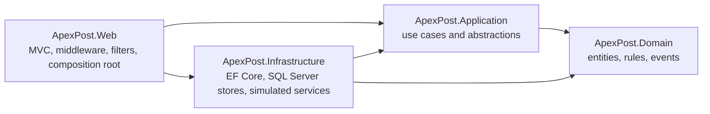
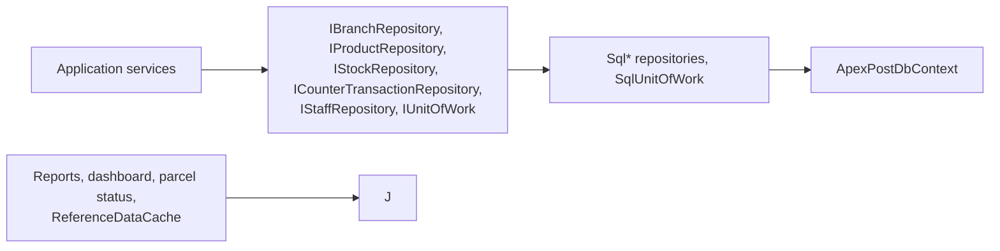
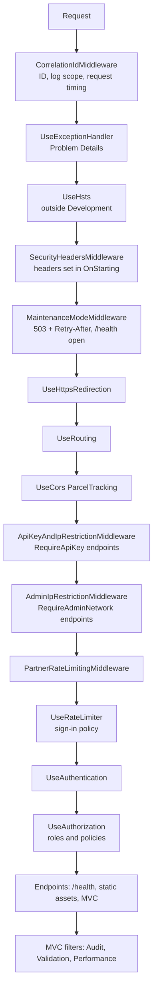

# ApexPost Counter Platform — Design

This document describes the platform as implemented on the `master` branch. Where something is planned but not built, it says so. Decisions are recorded as ADRs in [docs/adr/](docs/adr/); a short request-flow walkthrough is in [docs/architecture.md](docs/architecture.md). **The application runs on SQL Server** since Week 3 M3 ([section 4.6](#46-sql-server-cutover)). The schema is in [section 4.4](#44-sql-server-schema), and the repositories in [section 4.5](#45-repositories-and-unit-of-work).

## 1. Architecture

### Layers

| Project | Responsibility | Depends on |
|---|---|---|
| `ApexPost.Domain` | Entities, value objects, business rules, domain services, events, specifications and report calculations. No I/O. | — |
| `ApexPost.Application` | Use cases (application services), persistence/security/audit/courier/verification abstractions, the domain-event publisher, the reference-data cache and request validation. | Domain |
| `ApexPost.Infrastructure` | `ApexPostDbContext`, EF Core mappings and migrations, SQL Server repositories and stores, demo seed, and the simulated courier and identity-verification services. | Application, Domain |
| `ApexPost.Web` | MVC controllers and views, middleware, filters, authentication, authorization policies, the partner API and the composition root (`Program.cs`). | Application, Infrastructure |



Dependencies point inward. Application owns the interfaces (`IBranchRepository`, `IProductRepository`, `IStockRepository`, `ICounterTransactionRepository`, `IStaffRepository`, `IUnitOfWork`, `ICurrentStaffAccessor`, `IReportQueryService`, `IScreenQueryService`, `IStoredProcedures`, `IStaffCredentialRepository`, `IAuditStore`, `ICourierTrackingService`, `IIdentityVerificationService`); Infrastructure implements them ([section 4.5](#45-repositories-and-unit-of-work)); Web wires them together. Until M3 a temporary `SnapshotStore` in Application bridged them to the JSON store. Its successor in the tests, and the test-only `IApexPostRepository`, are in `tests/` ([section 4.10](#410-week-3-trainer-feedback)). Controllers translate HTTP to application calls and back. They hold no business rules, and `Program.cs` only reads configuration, registers services and builds the pipeline.

**Did the Week 1 architecture survive?** This repository starts at the ApexPost solution (first commit: "initialize ApexPost solution structure"), so the Week 1 TechNova code is not in its history. The four-layer split shown above was chosen for ApexPost from the start, with the domain rebuilt around branches, counters, a mixed basket and postal/financial services. *Author to confirm against the Week 1 submission.*

### Domain model


- **Entities** have identity and a lifecycle: `Branch`, `Staff`, `Product`, `BranchStock`, `TransactionBasket`, `TransactionLineItem`, `ShippingItem`, `MoneyOrder`, `Payment`, `ShippingZone`, `StockAdjustment`.
- **Value objects** are immutable `sealed record`s that validate on construction: `Money`, `Sku`, `BranchCode`, `Weight`, `Dimensions`, `ShippingRate`, `IdentityVerification` (holds only the masked identifier), `CounterSaleDetails`, and `TransactionTaxRate`.
- **References by ID:** `Payment` and `StockAdjustment` hold IDs and codes, not object references. `ShippingItem` and `ShippingRate` refer to a `ShippingZone` by its code in `DestinationZone`. The database enforces these links with foreign keys. No application service creates `Payment` or `StockAdjustment` objects yet; that starts in M2.
- **The mixed basket uses composition, not inheritance.** A basket holds `TransactionLineItem`s, each with a `TransactionItemType` (`Goods`, `Service`, `MoneyOrder`) and at most one attached shipping item or money order. Rules that differ by line type are `switch` expressions on that type, for example money-order lines carry no tax. This keeps one totals calculation and one lifecycle for every kind of sale.
- **Basket lifecycle:** Open → Paid, Open → Voided, Paid → Voided, and Paid → Refunded. Voiding or refunding a paid sale returns its stock and cancels its money orders exactly once (`SaleReversalService`, [ADR 0011](docs/adr/0011-void-and-refund-of-completed-sales.md)).

### Pricing and tax

- **Shipping** uses `ShippingPricingService`, a rule object built from persisted `ShippingRate` records keyed by `(destination zone, service level)`. The price is `base price + weight in kg × per-kg charge`. A missing rate is an error, never a fallback ([ADR 0005](docs/adr/0005-configured-shipping-pricing-and-limits.md)). `ShippingWeightLimitRule` rejects parcels over the configured maximum for their service level; letters are exempt.
- **Tax** is a per-category rate dictionary (`Transactions:TaxRates:<TaxCategory>`) passed into the basket. Each line is taxed by its `TaxCategory`. Shipping lines use `Shipping:TaxCategory`, and money-order principal is not taxed. The money-order fee is a separate line with `MoneyOrders:Fee:TaxCategory`.
- **No values in code.** No price, tax rate, weight limit, threshold or fee has a default. If one is missing, the affected workflow is disabled (or fails closed) rather than guessing.

## 2. Business rules

| Rule | Enforced by |
|---|---|
| Branch stock never goes negative; a sale fails if any line lacks stock (all lines are checked before any stock is deducted) | `SaleProcessingService`, `BranchStock` |
| Inactive staff cannot process; clerks and managers transact only at their home branch; the clerk on the sale must be the signed-in staff member | `TransactionProcessingRule` |
| A closed branch, or an inactive or unknown counter, cannot take transactions | `TransactionProcessingRule` |
| A money order above the configured threshold needs a successful identity verification in the same transaction, decided by the verification service, not the user | `MoneyOrderIdentityVerificationRule`, `MixedBasketApplicationService` |
| Parcels over the configured maximum for their service level are rejected | `ShippingWeightLimitRule` |
| Voids and refunds need an active Branch Manager of the same branch and a reason | `TransactionVoidRefundRule` |
| Full identity-document numbers are never stored; only the last four characters are kept | `IdentityVerification` |
| A transaction ID can be processed once; repeated submissions do not deduct stock twice | `ICounterTransactionRepository.ExistsAsync` inside `IUnitOfWork.ExecuteInTransactionAsync`; on SQL Server the primary key also enforces it |

## 3. Reports, events and notifications

### Reports

| Report | Who | Notes |
|---|---|---|
| Daily branch sales (goods vs. services) | Branch Manager | Filters by business date using `OccurredAtUtc` (UTC) |
| Low stock per branch | Branch Manager | Threshold is `Reports:LowStockThreshold`; the page returns 503 until it is configured |
| Shipping volume by zone and service level | Auditor, Administrator | |
| Money orders and identity verifications per branch | Auditor, Administrator | Includes cancelled money orders |

Report filters are composable specifications (`PaidTransactionSpecification`, `TransactionAtBranchSpecification`, `TransactionOnBusinessDateSpecification`), combined with `And` and applied with the `Matching` extension member.

### Dashboard

`/` shows a branch dashboard for signed-in staff. `BranchDashboardApplicationService` starts the reference-data load and the courier lookups for recent shipments at the same time and awaits them with `Task.WhenAll`. Sales and stock panels are shown to Branch Managers only.

The page shows KPI cards (branch status, counters, products, shipping zones and, for managers, today's transactions and sales), a sales-mix chart, a counter-availability chart and a low-stock chart against the threshold. Every figure comes from `DashboardViewModel`; see [User interface](#user-interface).

### User interface

The Week 3 UI modernization kept the controllers, view models, routes, form field names and role checks. Only views, static assets and two presentation-only files changed. Evidence, with screenshots at three widths, is in [docs/evidence/ui](docs/evidence/ui/README.md).

| Part | Where |
|---|---|
| Shell: sidebar by role, top bar, user menu, footer | `Views/Shared/_Layout.cshtml`, `_SidebarNav.cshtml`, `_BrandMark.cshtml` |
| Design system: colour tokens, cards, KPI cards, tables, badges, forms, tabs, charts, print styles | `wwwroot/css/site.css` |
| Behaviour: sidebar collapse and phone overlay, table search, filter, sort and paging, confirmation dialogs, validation feedback, busy buttons, toasts, remembered tabs | `wwwroot/js/site.js` |
| Icons, drawn for the project | `wwwroot/img/icons.svg`, used through `Html.Icon` in `Ui/UiHtmlHelperExtensions.cs` |
| Status badges (text always shown, colour as a cue) | `Html.StatusBadge` in `Ui/UiHtmlHelperExtensions.cs` |
| Charts, toasts, empty states, server validation summary | `_BarChart`, `_DonutChart`, `_StatusToast`, `_EmptyState`, `_ValidationSummary` partials, with the records in `Models/UiViewModels.cs` |

- **No new libraries.** The UI uses the Bootstrap 5.3.3, jQuery and validation files already in `wwwroot/lib`. Charts are server-rendered SVG, so no chart library is needed.
- **CSP stays `default-src 'self'`.** There are no inline scripts, handlers or style attributes, and no external fonts or CDNs. Bar widths and donut segments are SVG attributes, which the policy allows. Bootstrap's embedded `data:` icons for selects, checkboxes and close buttons are blocked by the policy, so they are served from `wwwroot/img/ui`. `asp-validation-summary` emits an inline style, so the forms without client validation use `_ValidationSummary` instead.
- **Data is never invented.** Charts and KPI cards count rows each page already receives. Administration totals stay on the Administration page, behind its admin-network filter, rather than appearing on the dashboard.
- **Roles.** The sidebar repeats each controller's role check, so it never offers a page the user cannot open. Void and refund forms still appear only to Branch Managers.
- **No branch from the cookie.** The top bar does not show a branch, because the sign-in claim can be stale. Pages show the persisted home branch. A web test that tampers with the claim caught an early version that did.
- **Destructive actions** (void, refund, closing a branch) ask for confirmation in a dialog. Without JavaScript, the forms still post and the server still validates.
- **Responsive.** Below 992 px the sidebar becomes an overlay. On phones, KPI cards sit two to a row, and tables scroll inside their card, so the page never scrolls sideways.
- **Branch Close and Reopen buttons fixed.** The hidden `IsActive` field was written as `value="@(!branch.IsActive)"`, and Razor drops a `false` attribute value and writes `value` for `true`. In a browser, Close posted an empty value and Reopen posted `value`, and both were rejected with 400. The view now writes `"false"` or `"true"`. The tests post the form fields directly, so they did not catch this; a browser check of the real button did.
- **Kept for tests and evidence.** The cells the web tests and the Postman collection read, such as the Daily sales amounts and the catalogue rows, stay plain `<td>` text. So do the headings, field names and the print button's text.

Not built, because no backend supports them: a multi-day sales trend (reports cover one business date), branch switching (staff work at their home branch), a notification feed (notifications are log entries), and an audit-log viewer.

### Domain events and simulated notifications

| Event | Raised when |
|---|---|
| `TransactionCompletedEvent` | A sale is processed |
| `StockLowEvent` | A sale or adjustment takes a product from above the threshold to at or below it (crossing only, so no repeats) |
| `MoneyOrderIssuedEvent` | A money order is issued |
| `HighValueMoneyOrderIssuedEvent` | The issued order is above the threshold |
| `TransactionVoidedEvent` | A sale is voided |
| `TransactionRefundedEvent` | A sale is refunded |

Events are collected inside `IUnitOfWork.ExecuteInTransactionAsync` and published by `DomainEventPublisher` only after it has committed, so a rejected or rolled-back change never notifies anyone. `SimulatedNotificationSender` subscribes to the publisher's C# events and writes the four required notifications (low stock, high-value money order, void, refund) as structured warning logs prefixed `Simulated notification:`. A failing subscriber is logged and cannot undo the committed change ([ADR 0012](docs/adr/0012-committed-domain-events-and-simulated-notifications.md)).

## 4. Persistence

> **Historical.** The bullets below up to section 4.4 describe the JSON store used until Week 3 M3. The application no longer uses it, and its classes were removed in Week 3 ([section 4.6](#46-sql-server-cutover)).

- **Store:** `JsonApexPostRepository` kept one versioned `apexpost.json` snapshot in `Storage:Directory`. Infrastructure mapped it through DTOs and rebuilt domain objects through their validating constructors; it never deserialized straight into entities.
- **Concurrency:** `UpdateAsync(Func<snapshot, snapshot>)` held a `SemaphoreSlim` across load, change and save, and the repository wrote to a temporary file before moving it into place ([ADR 0001](docs/adr/0001-json-snapshot-persistence.md), [ADR 0004](docs/adr/0004-atomic-transaction-processing.md)). SQL Server concurrency is in [ADR 0021](docs/adr/0021-concurrency-strategy.md).
- **Schema migration:** the current schema is 7.

  | Version | Change |
  |---|---|
  | 2–4 | Transaction IDs, money-order verification links, basket branch and shipping-line links |
  | 5 | Transaction `OccurredAtUtc` |
  | 6 | Money-order `Id` and `Status`, and line-to-money-order links |
  | 7 | Sale details: counter, clerk and payment method |

  Older files are migrated on load without inventing business data; for example, undated legacy sales stay undated. A file without a version that contains newer fields is rejected.
- **Failure behaviour:** a missing file is an empty snapshot. A malformed, unsupported or domain-invalid file fails loudly and is never overwritten.
- **Other stores:** credentials lived in a separate file ([ADR 0007](docs/adr/0007-separate-staff-credential-store.md)), and audit records in a JSON Lines file. Both are now tables.

### 4.4 SQL Server schema

Week 3 M1 added the schema and mapping, and M3 moved the application onto them. Decisions are in [ADR 0017](docs/adr/0017-money-precision-and-rounding.md) (money precision), [ADR 0018](docs/adr/0018-schema-design-and-delete-behaviours.md) (schema and deletes) and [ADR 0019](docs/adr/0019-domain-and-persistence-separation.md) (domain and persistence models).

#### ER diagram

Every table also has `CreatedAtUtc`, `CreatedBy` and `ModifiedAtUtc`, left out here for space.

Cardinalities follow the nullability of each foreign key:
- **Optional sale details.** `CounterTransactions.CounterId` and `ClerkStaffId` are nullable together (`CK_CounterTransactions_SaleDetails`), so a transaction has zero or one counter and clerk.
- **Optional line links.** `TransactionLines.Sku`, `ShipmentId` and `MoneyOrderId` are nullable, and the last two have filtered unique indexes, so a shipment or money order is billed on at most one line.
- **Empty baskets.** A transaction can have zero lines: `TransactionApplicationService.CreateBasketAsync` saves an empty `Open` basket, and only payment requires a line.
- **Composite counter key.** The counter link is the composite key `(BranchCode, CounterId)`, added by hand in `InitialCreate`.
- **Delete behaviours.** All 22 foreign keys are `NO ACTION` except `TransactionTaxRates` → `CounterTransactions` (`CASCADE`), as in [ADR 0018](docs/adr/0018-schema-design-and-delete-behaviours.md).
- **No audit links.** `AuditEntries` has no foreign keys.


The table count is 19: the 17 the brief lists, plus `TransactionTaxRates` and `StaffCredentials`.

#### Normalization note (3NF)

Every non-key column depends only on its table's key. Three concrete anomalies this design prevents:

| Anomaly | Without this design | How the schema prevents it |
|---|---|---|
| **Update** | If each sale copied the branch's name and region, renaming a region would mean updating every sale, and a missed row would leave reports disagreeing | Name and region exist once, in `Branches`. `CounterTransactions` holds only `BranchCode` |
| **Insertion** | If stock and product details shared a table, a product could not be added to the catalogue until a branch stocked it. If zones existed only as text on rates, a zone could not exist before its first rate, and a typo would create a new zone | `Products` is separate from `BranchStock`. `ShippingZones` is separate, and `ShippingRates` and `Shipments` must reference a real zone |
| **Deletion** | If product details lived only on transaction lines, losing the last line for a product would lose the product | `Products` stands alone, and `Restrict` stops a referenced product being deleted |

**Deliberate exceptions:**
- `TransactionLines.Description`, `UnitPrice` and `TaxCategory` are copied from the product at sale time. They are not redundant: they record what was charged then, and they must not change when a price changes.
- `TransactionLines.Currency` repeats the transaction's currency, because `Money` is stored as a whole value. The domain rejects a line in another currency (`TransactionBasket.AddLineItem`).
- `PaymentMethod` is on both `CounterTransactions` and `Payments`, recording different facts. The transaction column is the method selected for the sale; the payment column is the method used for that financial movement, so a refund can record how the money went back. For a normal sale the two match. Neither is edited after it is written ([ADR 0018](docs/adr/0018-schema-design-and-delete-behaviours.md)).

#### Mapping reference

Code: `src/ApexPost.Infrastructure/Persistence/Sql/`.

| Concern | Implementation |
|---|---|
| DbContext | `ApexPostDbContext`, scoped use from M2; the configurations are applied with `ApplyConfigurationsFromAssembly` |
| Design-time creation | `ApexPostDbContextFactory`: holds no connection string, so generating a migration or script never reads secrets or touches a database |
| Fluent configuration | `Configurations/`: one `IEntityTypeConfiguration` class per entity, 18 in all. The 19th table, `TransactionTaxRates`, is an owned collection configured inside `CounterTransactionConfiguration` |
| Shared column rules | `MappingExtensions`: `IsBranchCode`, `IsSku`, `IsCode`, `IsEnumCode`, `IsMoney`, `IsUtcDateTime`, `IsActiveFlag`, `HasAuditColumns` |
| Value converters | `ValueConverters.cs`: `BranchCodeConverter`, `SkuConverter`, `WeightConverter`, `MoneyAmountConverter`, `UtcDateTimeOffsetConverter`, `RouteValuesConverter` |
| Complex types | `Money` (two columns, so a converter handles its amount and the type maps as a complex property, safely shared between objects) and `Dimensions` |
| Owned types | `CounterSaleDetails` (optional, stored on `CounterTransactions`) and `TransactionTaxRate` (owned collection, stored in `TransactionTaxRates`) |
| Shadow properties | `RowVersion`; `CreatedAtUtc`, `CreatedBy`, `ModifiedAtUtc`; surrogate keys such as `BranchId`; foreign keys such as `TransactionId` on lines |
| Backing fields | `_lineItems`, `_counterTerminals`, `_taxRates`, `_reversalReason`, `_branchCode`, `_paymentStatus` |
| Separate persistence model | `IdentityVerificationRecord` and `IdentityVerificationMapper` |
| `varchar` codes | `IsUnicode(false)` with a maximum length on every code column. Verified: EF sends `@sku varchar(30)`, so an indexed code column is not compared through an implicit conversion |
| Health check | `SqlServerConnectivityHealthCheck` uses `Database.CanConnectAsync`, is mapped only in Development, and connects only when `/health/database` is requested |

`Address` on `Branch` was not added: the brief offers it as an example, nothing in ApexPost records one, and `Dimensions` and `CounterSaleDetails` already cover "complex and owned types where they fit".

#### Constraints

| Type | Count | Examples |
|---|---|---|
| UNIQUE | 6 | `UQ_Branches_BranchCode`, `UQ_Products_Sku`, `UQ_Staff_Email`, `UQ_ShippingZones_ZoneCode`, `UQ_Roles_Name`, `UQ_ProductCategories_Name` |
| CHECK | 33 | `CK_BranchStock_Quantity` (≥ 0), `CK_MoneyOrders_Amount` and `CK_Payments_Amount` (> 0), `CK_Shipments_Weight` (> 0), `CK_CounterTransactions_Status`, `CK_IdentityVerifications_MaskedDocumentIdentifier` |
| DEFAULT | 43 | Three audit defaults per table (`SYSUTCDATETIME()`, `SUSER_SNAME()`) are the main group, plus `IsActive`, `Quantity` and `Status` |
| Foreign key | 22 | 21 `NO ACTION`, 1 `CASCADE`; see [ADR 0018](docs/adr/0018-schema-design-and-delete-behaviours.md) |
| Rowversion | 2 | `BranchStock.RowVersion`, `CounterTransactions.RowVersion`, both `NOT NULL` |

Identity documents are stored only as `****` plus the last four characters, in `varchar(8)` with a CHECK that also rejects any other format. The domain's `IdentityVerification` masks first, so a full number never reaches the mapper.

#### Migrations

| Item | Location |
|---|---|
| Migration | `src/ApexPost.Infrastructure/Persistence/Sql/Migrations/20261031085407_InitialCreate.cs` |
| Idempotent script | `sql/schema/ApexPostDb-idempotent.sql` |
| Follow-up migrations | `AddStoredProcedures`, `AddPerformanceIndexes`, `AddDailyBranchSalesRecompile` |

The application never calls `EnsureCreated()` or migrates at startup. `InitialCreate` was reviewed by hand. The review made `CreatedBy`, `RowVersion` and `TransactionLines.TransactionId` non-nullable, and added the composite counter foreign key by hand.

**Historical note, at the end of M1:** `ApexPostDb` on the default instance had not been migrated. Verification used a separate disposable database.

#### M1 traceability

Verification ran on 2026-10-31 on SQL Server 2025 (17.0) Enterprise Evaluation, in a disposable database in `E:\SqlData\ApexPost\Tests`, since dropped. The EF round-trip checks were a throwaway probe, not repository tests; automated tests follow in the approved testing phase.

| Assignment requirement | Implementation | Documentation | Verification evidence |
|---|---|---|---|
| Part A: required tables | `Configurations/*.cs` | ER diagram above | 19 user tables after applying the script |
| A: PKs, FKs, delete behaviour | `Configurations/*.cs`; hand-written FK in `InitialCreate` | ADR 0018 | 22 FKs. Deleting a referenced branch and product was rejected. A counter from another branch was rejected |
| A: UNIQUE constraints | `HasAlternateKey` in `BranchConfiguration`, `ProductConfiguration`, `StaffConfiguration` | Constraints table | Duplicate `BranchCode`, `Sku` and email each rejected |
| A: CHECK constraints | `HasCheckConstraint` in each configuration | Constraints table | Negative stock, invalid status, zero amount, zero weight, unmasked document and a reason on a paid sale each rejected |
| A: DEFAULT and audit columns | `MappingExtensions.HasAuditColumns`, `IsActiveFlag` | Constraints table | Every table has all three audit columns; 43 defaults |
| A: rowversion | `BranchStockConfiguration`, `CounterTransactionConfiguration` | Constraints table | Both `NOT NULL`. Two contexts selling the same stock: the second got `DbUpdateConcurrencyException`, and stock stayed at 0 |
| A: data types | `MappingExtensions` | Mapping reference, ADR 0017 | Catalog query: 70 `varchar`/`char` columns, money `decimal(18,2)`; the 19 `nvarchar` columns are all names or free text, counted from `InitialCreate` after `Payments.PaymentMethod` was added |
| A: masked documents | `IdentityVerification`, `IdentityVerificationMapper`, `IdentityVerificationConfiguration` | ADR 0019 | `ABCDEFGH1234` stored as `****1234`; an unmasked value and an over-long value were rejected |
| A: ER diagram, three anomalies | This section | This section | Review |
| A: idempotent script | `sql/schema/ApexPostDb-idempotent.sql` | Migrations table | Applied twice to one database: both runs exited 0, and one history row was recorded |
| E: `ApexPostDbContext` | `ApexPostDbContext.cs` | Mapping reference | Round trip of a sale with goods, shipping and money-order lines |
| E: Fluent configuration per entity | `Configurations/*.cs` | Mapping reference | `has-pending-model-changes` reports no changes |
| E: value converters | `ValueConverters.cs` | Mapping reference, ADR 0017 | `BranchCode`, `Sku`, `Weight` and UTC times round-tripped; 11.255 stored as 11.26 |
| E: owned and complex types | `TransactionConfigurations.cs`, `ShippingConfigurations.cs` | Mapping reference | `CounterSaleDetails`, tax rates, `Money` and `Dimensions` round-tripped; null sale details stayed null |
| E: `InitialCreate` | `Migrations/20261031085407_InitialCreate.cs` | Migrations table | Applied by script and by `dotnet ef database update`; reverted to 0 tables and re-applied to 19 |
| A: `Payments` with its payment method | `Payment.cs`, `PaymentConfiguration` in `TransactionConfigurations.cs` | Normalization note, ADR 0018 | `Payments.PaymentMethod` is `nvarchar(50) NOT NULL`, and a NULL insert was rejected. `CounterTransactions.PaymentMethod` stays `nvarchar(50) NULL`. A sale selected `Card` while its refund entry recorded `Cash`, and both round-tripped |
| E: never `EnsureCreated()` | No call in `src` | Migrations table | `grep` of `src` found no `EnsureCreated` or `Migrate` call |
| F: rich entities, shadow properties | Domain entities; `HasAuditColumns`, `RowVersion` | ADR 0019 | Round trip through private constructors and backing fields |
| F: separate persistence entity and mapper | `IdentityVerificationRecord.cs` | ADR 0019 | Mapper round trip to `IdentityVerification.FromMaskedIdentifier` |
| Plan: `varchar` with `IsUnicode(false)` | `MappingExtensions.IsCode`, `IsBranchCode`, `IsSku`, `IsEnumCode` | Mapping reference | `ToQueryString()` shows `DECLARE @sku varchar(30)` |
| Plan: health check through EF Core | `SqlServerConnectivityHealthCheck.cs` | Mapping reference, README | `/health/database` returned `200 Healthy`; the existing health check tests passed |
| Week 2 rules preserved | Domain changes in ADR 0019 | ADR 0019 | All 558 existing tests passed after the `Payments.PaymentMethod` correction: Domain 213, Application 110, Infrastructure 38, Web 197. No test file was modified. These tests verify existing behaviour on JSON persistence, not the new SQL persistence. SQL schema and mapping were verified separately with throwaway probes on disposable databases, which are not repeatable automated tests |

**Historical note, at the end of M1:** repositories and the Unit of Work, stamping of `ModifiedAtUtc` and the real `CreatedBy`, seed data, and automated SQL tests were not yet implemented. Later milestones delivered them.

### 4.5 Repositories and Unit of Work

Week 3 M2 moved the application services onto repository and unit-of-work interfaces, and M3 removed the temporary `SnapshotStore` bridge that kept them on JSON in between. Decisions are in [ADR 0020](docs/adr/0020-repository-and-unit-of-work-boundaries.md) and [ADR 0021](docs/adr/0021-concurrency-strategy.md).



| Concern | Implementation |
|---|---|
| Interfaces | `src/ApexPost.Application/Persistence/` |
| SQL implementations | `src/ApexPost.Infrastructure/Persistence/Sql/SqlRepositories.cs`, `SqlUnitOfWork.cs` |
| Registration, all scoped | `SqlPersistenceRegistration.AddApexPostSqlPersistence` |
| Commit and retry | `IUnitOfWork.ExecuteInTransactionAsync` |
| Audit stamping | `AuditColumnsInterceptor`, `ICurrentStaffAccessor` |
| Input limits | `InputLimits`, `[MaximumLength]`: text lengths, and the largest value each decimal column holds |
| Failed use case | `SqlUnitOfWork` clears the change tracker, so nothing from a failed attempt reaches a later read |
| Set-based price revision | `SqlProductRepository.RevisePricesAsync` (`ExecuteUpdateAsync`), `AdministrationApplicationService.RevisePricesAsync`. No screen calls it yet |
| Void requires a Branch Manager | `TransactionsControllerVoidTests.cs`: on a real sale in SQL Server, every other role and a manager demoted or deactivated mid-session are refused, and the rowversions of the transaction and stock rows do not change. A manager's void returns the stock and adds the `Refund` entry |
| Repository translation on SQL Server | `RepositoryTranslationTests`: value-object filters and lists, the UTC day bounds, the last supported date, the reads no other test ran, and the `ORDER BY` sent. The repositories and query services have no paging |
| Input → command → entity | Every form that changes business data binds a validated view model, maps it to a command record and then to domain entities; see [the mapping table](#input-model--application-command--entity). The sale form's posted fields include no status or audit values, and its posted `TransactionId` is the idempotency key. Over-posting evidence is in [section 4.8](#48-query-services-and-read-projections) |

**Behaviour changes from M2:**
- Text longer than its column, and numbers too large for theirs, are now rejected as validation errors.
- `AdjustStockAsync` records a fixed reason, "Manual stock adjustment", on the history row, because the screen does not ask for one.
- A refund, and a void of a paid sale, each write a `Refund` entry on SQL Server only. **These entries are inferred, not required by the brief, and are pending trainer confirmation** ([ADR 0020](docs/adr/0020-repository-and-unit-of-work-boundaries.md)).

#### Input model → application command → entity

`AssignmentWeek03.txt` line 129 asks for explicit mapping from input model to application command to entity. Each form binds a validated view model, its controller builds an immutable command record, and the service overload delegates to the existing use case, so validation and business rules stay in one place. The acting staff ID is a separate argument taken from the sign-in claim, never from the form. The older service signatures remain, so existing tests are unchanged.

| Operation | Input model and action | Command record | Service overload | Entity or table | Mapping test (`ApplicationCommandTests.cs`) |
|---|---|---|---|---|---|
| Sale | `CreateTransactionViewModel`, `TransactionsController.Create` | `CounterBasketRequest` | `MixedBasketApplicationService.CreateAndProcessAsync` | `TransactionBasket`, `Payments` | `Sale_CommitsOnce_AndRecordsItsPayment` |
| Create staff | `CreateStaffViewModel`, `AdministrationController.CreateStaff` | `CreateStaffCommand` | `AdministrationApplicationService.AddStaffAsync` | `Staff` | `CreateStaffCommand_MapsEveryFieldToTheStaffEntity` |
| Update staff | `UpdateStaffViewModel`, `AdministrationController.UpdateStaff` | `UpdateStaffCommand` | `AdministrationApplicationService.UpdateStaffAsync` | `Staff` | `UpdateStaffCommand_MapsEveryFieldToTheStaffEntity` |
| Create branch | `CreateBranchViewModel`, `AdministrationController.CreateBranch` | `CreateBranchCommand` | `AdministrationApplicationService.AddBranchAsync` | `Branch`, `CounterTerminal` | `CreateBranchCommand_MapsEveryFieldToTheBranchEntity` |
| Set branch status | `SetBranchStatusViewModel`, `AdministrationController.SetBranchStatus` | `SetBranchStatusCommand` | `AdministrationApplicationService.SetBranchStatusAsync` | `Branch` | `SetBranchStatusCommand_ReachesTheBranchEntity` |
| Create product | `CreateProductViewModel`, `AdministrationController.CreateProduct` | `CreateProductCommand` | `AdministrationApplicationService.AddProductAsync` | `Product` | `CreateProductCommand_MapsEveryFieldToTheProductEntity` |
| Adjust stock | `StockAdjustmentViewModel`, `StockController.Adjust` | `AdjustStockCommand` | `StockAdjustmentApplicationService.AdjustStockAsync` | `BranchStock`, `StockAdjustment` | `AdjustStockCommand_ReachesTheStockAndItsHistoryRow` |
| Void | `TransactionActionViewModel`, `TransactionsController.Void` | `VoidTransactionCommand` | `TransactionApplicationService.VoidAsync` | `TransactionBasket`, `Payments` | `VoidTransactionCommand_ReachesTheBasketWithItsReason` |
| Refund | `TransactionActionViewModel`, `TransactionsController.Refund` | `RefundTransactionCommand` | `TransactionApplicationService.RefundAsync` | `TransactionBasket`, `Payments` | `RefundTransactionCommand_ReachesTheBasketWithItsReason` |

The rule tests in the same file, such as `CreateStaffCommand_KeepsTheDuplicateRule` and `VoidTransactionCommand_KeepsTheBranchManagerRule`, prove that the overloads add no path around the existing rules, and `EveryOverload_RefusesANullCommand` covers all eight. The sale's test is in `UnitOfWorkBoundaryTests.cs`. Focused runs on 2026-11-01 passed: Application 66 of 66, Web 111 of 111, which post real forms through these commands, and Infrastructure 42 of 42.

#### M2 traceability

Verification first ran on 2026-10-31 on a disposable database, using throwaway probes that ran the real services. The M3 testing phase replaced those with the repeatable tests in `tests/ApexPost.Infrastructure.Tests/Sql/SqlPersistenceTests.cs`.

| Assignment requirement | Implementation | Documentation | Verification evidence |
|---|---|---|---|
| F: dependency direction | Interfaces in Application, implementations in Infrastructure | ADR 0020, diagram above | Domain and Application reference no EF Core packages |
| F: specific repositories | `IBranchRepository`, `IProductRepository`, `IStockRepository`, `ICounterTransactionRepository`, `IStaffRepository` | ADR 0020 | Sale, void, refund, stock adjustment and administration ran on them on SQL Server |
| F: stage only, no `IQueryable` | `SqlRepositories.cs` | ADR 0020 | Review of `SqlRepositories.cs`: public methods return entities or lists. `RevisePricesAsync` is the documented exception |
| F: `IUnitOfWork`, one commit per use case | `SqlUnitOfWork`, migrated services | ADR 0020 | `SaleRollbackTests`: a sale that fails after its rows are written, or on a SQL Server error during the save, leaves no transaction, line, tax rate, payment, shipment, money order, verification or stock change |
| F: scoped lifetimes | `AddApexPostSqlPersistence` | ADR 0020 | The probe resolved one scope per use case |
| F: persistence entity and mapper | `SqlCounterTransactionRepository`, `MoneyOrder.RestoreIdentityVerification` | ADR 0019, ADR 0020 | Basket and money-order reads returned the restored verification |
| F: Week 2 tests unchanged | `SnapshotStore` and the `IApexPostRepository` constructors, at M2 | ADR 0020 | At M2, all 558 existing tests passed with no test file changed, on JSON through the bridge. Later Week 3 changes are described in [section 4.10](#410-week-3-trainer-feedback): the Week 2 Domain business-rule tests still run unchanged |
| E: one `SaveChangesAsync` per sale | `MixedBasketApplicationService.ProcessAsync` | ADR 0020 | Sale saved transaction, lines, shipment, money order, verification, payment and stock together |
| E: `ExecuteUpdateAsync` | `SqlProductRepository.RevisePricesAsync` | ADR 0020 | 33.33 × 1.1 stored as 36.66; another category unchanged. `RevisePrices_UsesEveryDecimalOfTheMultiplier`: 33.33 × 1.125 stored as 37.50 |
| E: concurrency | `SqlUnitOfWork`, rowversion | ADR 0021 | 20 sales of 10 units: 10 sold, stock 0. Retry reloaded state; repeated conflicts gave `ConcurrencyConflictException`; `TransactionsControllerConcurrencyTests.cs` runs real two-connection conflicts through HTTP |
| E: explicit transaction with execution strategy | `SqlUnitOfWork.ExecuteInTransactionAsync` | ADR 0021 | Ran with `EnableRetryOnFailure` configured. A transient failure was not simulated |
| Plan: events once | `committedEvents` in services | ADR 0021 | 10 completed events for 10 committed sales. `SaleRollbackTests`: no event for a sale that fails after writing, and the events fire when the same request then succeeds |
| Implemented, pending trainer confirmation: void and refund entries | `TransactionApplicationService.RecordRefundEntryAsync`, `ICounterTransactionRepository.FindPaymentAsync` | ADR 0020, ADR 0017 | Void of a paid sale and a refund each add one `Refund` entry. The project owner approved that it equals the amount originally paid, so it copies the stored `Payment`. `Reversal_OfASaleWithShipping_RefundsExactlyTheStoredPayment`, `Reversal_CopiesTheStoredPayment`, `Reversal_WithNoStoredPayment_WritesNoRefundEntry` and `VoidOfOpenBasket_WritesNoRefundEntry`. Focused runs on 2026-11-01: Application 40 of 40, Infrastructure 78 of 78, Web 98 of 98 |
| Plan: audit stamping | `AuditColumnsInterceptor` | ADR 0020 | `CreatedBy` and `ModifiedAtUtc` were stamped |
| Plan: input limits | `InputLimits` | ADR 0020 | A 501-character reason was rejected before saving |
| Numeric limits | `InputLimits.Ensure`, `MixedBasketApplicationService`, `AdministrationApplicationService` | ADR 0020 | Oversized weight rejected with no rows written |
| Failed use case clears tracked state | `SqlUnitOfWork.ExecuteInTransactionAsync` | ADR 0020 | No tracked entries after a failed attempt; tracked entries kept after a success |

**Historical note, at the end of M2:** the report and dashboard query services were not yet implemented; M5 delivered them. Tests for fakes, a spy Unit of Work and over-posting followed in the M3 testing phase.

### 4.6 SQL Server cutover

Week 3 M3 moved the Web application from JSON to SQL Server. `Program.cs` requires `ConnectionStrings:ApexPostDb` and registers `AddApexPostSqlPersistence`. `SnapshotStore` and the `IApexPostRepository` service constructors are gone, which also resolves the DI ambiguity on `StaffAuthenticationService`.

| Concern | Implementation |
|---|---|
| Reports, dashboard, parcel status | The Domain report classes are unchanged. M3 read through repositories and calculated in memory; M5 moved production reads to query services ([section 4.8](#48-query-services-and-read-projections)) |
| Added repository reads | `GetMoneyOrdersAsync`, `GetShipmentsAsync`, `FindByShipmentIdAsync`. The first two were removed after the Week 3 trainer feedback, when no production code read them any more |
| `ReferenceDataCache` | Loads through `IReferenceDataSource`. `SqlReferenceDataSource` opens a short-lived scope, because the cache is a singleton |
| Audit | `SqlAuditStore`, in its own scope and commit ([ADR 0022](docs/adr/0022-audit-store-and-unit-of-work.md)) |
| Credentials | `SqlStaffCredentialRepository`, in `StaffCredentials` |
| Demo seed | `SqlDemoDataSeeder` writes `DemoDataInitializer`'s data in one commit: 5 branches, 20 staff, 30 products, 10 zones, 16 rates, and 270 paid sales with payments, of which 40 carry shipments and 20 carry money orders |
| Current staff | `HttpContextStaffAccessor` supplies `CreatedBy` |
| Problem Details | `ApplicationExceptionHandler` maps `ConcurrencyConflictException` and `DuplicateRecordException` to 409, `KeyNotFoundException` to 404 and `ArgumentException` to 400. Anything else is a logged 500 with safe Problem Details. Browser forms catch these themselves and answer with the view and the same status, including the administration forms. State conflicts are 409, a deliberate deviation from the brief's "domain errors → 400" ([ADR 0025](docs/adr/0025-domain-errors-and-http-status.md)) |
| Unique violations | `SqlUnitOfWork` translates SQL errors 2601 and 2627 to `DuplicateRecordException` |

**Legacy JSON removal.** SQL Server is the only persistence implementation. `JsonApexPostRepository`, `JsonAuditStore` and `JsonStaffCredentialRepository` were removed once a search of `src`, `scripts` and `sql` found no use outside their own files, and with them their 27 and 3 test cases, which tested only those classes. The eight `src/ApexPost.Web/App_Data/SeedData` files were removed too, because nothing loaded them; the Week 2 remarks had already noted that they were unused and did not match the C# seed. Demo data is written by `SqlDemoDataSeeder`, which `Program.cs` runs when `DemoData:Initialize` is true, from `DemoDataInitializer.CreateDemoSnapshot`. At that point `IApexPostRepository` stayed in Application, because 18 test files, including `FakeApexPostRepository` and `SqlSnapshotRepository`, depended on it. After the Week 3 feedback it moved to the tests ([section 4.10](#410-week-3-trainer-feedback)). Verified on 2026-11-01 with a clean `dotnet build ApexPost.slnx --no-incremental` (0 warnings, 0 errors), `dotnet test tests/ApexPost.Infrastructure.Tests --no-build` (233 of 233) and focused Application (30 of 30) and Web (39 of 39) runs. This is not a full-suite result.

**Demo shipments and money orders.** `DemoDataInitializer.CreateDemoServiceSales` builds both, and `SqlDemoDataSeeder` writes them in the same commit as the rest of the seed, so every report has data on a fresh demo.

| Seeded data | Records | Report | Evidence |
|---|---|---|---|
| Shipments, `DEMO-SHIP-0001` to `0040`, each on a paid sale | 40 parcels and letters across 10 zones and all three service levels. Six extra rates add `Express` and `Registered` to the first three zones, making 16 rates | `/Reports/ShippingVolume`, `SqlReportQueryService.ShippingVolume` | `DemoSeed_ShippingVolumeReport_CountsEverySeededShipment`: 16 rows, 40 shipments |
| Money orders, each on a paid sale with its fee | 20 at 5 branches: 5 with no check, 10 with a successful check and 5 with a failed check below the threshold. The five above 10,000 INR were all checked successfully | `/Reports/BranchAuditor`, `SqlReportQueryService.BranchAuditorReport` | `DemoSeed_BranchAuditorReport_CountsEverySeededMoneyOrder`: 5 branches, 20 orders, 15 checks |

These 60 sales bring the seed to 270 sales with 270 payments. Each money order passes `MoneyOrderIdentityVerificationRule` as it is built. `IdentityVerification` masks each fictional eight-character document number, so only values like `****0001` are stored; `DemoSeed_StoresOnlyMaskedDocumentIdentifiers` checks every stored row. The sales go through `ICounterTransactionRepository.Add`, which stores those verifications. Seeding stops if any branch, staff member or product exists, so `DemoSeed_RunningAgain_DuplicatesNothing` finds the same row counts. `DemoSeed_RecordsReferenceValidBranchesAndStaff` checks the clerk, branch, line and rate references, and `DemoProfile_AuditorSeesTheSeededShipmentsAndMoneyOrders` signs in through the `demo` profile and reads both report screens.

Focused runs on 2026-11-01:

```powershell
dotnet test tests/ApexPost.Infrastructure.Tests --no-build --filter "FullyQualifiedName~DemoSeed_|FullyQualifiedName~DemoCredentials_|FullyQualifiedName~DemoDataInitializerTests"
dotnet test tests/ApexPost.Web.IntegrationTests --no-build --filter "FullyQualifiedName~DemoProfileTests|FullyQualifiedName~ShippingVolumeReportsControllerTests|FullyQualifiedName~BranchAuditorReportsControllerTests"
```

These passed 12 of 12 and 16 of 16. This is not a full-suite result.

#### M3 traceability

Verified on 2026-10-31 by running the real application over HTTPS against a disposable seeded database in `E:\SqlData\ApexPost\Tests`, since dropped. That run was one-off. The repeatable equivalents are in [section 13](#13-testing). `ApexPostDb` on the default instance was not migrated for that run.

| Assignment requirement | Implementation | Documentation | Verification evidence |
|---|---|---|---|
| G: screens read and write SQL Server | `Program.cs`, `AddApexPostSqlPersistence` | This section | 34 live checks passed across clerk, manager, auditor and administrator, with no errors logged |
| G: reports through services | The report application services | This section | Daily sales, low stock, shipping volume and branch auditor pages returned 200 |
| G: `AuditEntries` through `IAuditStore` | `SqlAuditStore`, `AuditActionFilter` | ADR 0022 | 9 audit rows, including the 409 rejections |
| G: exceptions to Problem Details | `ApplicationExceptionHandler` | This section | `ProblemDetailsExceptionHandlingTests.KnownException_MapsToItsProblemDetails` covers all four mappings. `UncaughtConflict_ReturnsSafeProblemDetailsWith409` proves the 409 with a real conflict through a test-only endpoint. Real routes answer a conflict with a 409 view (ADR 0021). `TransactionsControllerErrorMappingTests.cs` covers real routes: a unique violation during the save, 400 and 404 through the handler, and a logged, safe 500 |
| G: connection string from user-secrets | `Program.cs` | README | Startup refuses to run without it. The live run supplied it through the environment |
| E: seed volumes | `SqlDemoDataSeeder` | This section | 5 branches, 10 counters, 20 staff, 20 credentials, 30 products, 150 stock rows, 10 zones, 10 rates |
| E: 200+ historical transactions | `SqlDemoDataSeeder` | This section | 210 seeded sales, plus the 1 made in the run, with no negative stock |
| Plan: `CreatedBy` from the signed-in staff member | `HttpContextStaffAccessor` | This section | The sale recorded `demo-staff-01`, and the refund entry `demo-staff-02` |
| Plan: partner API | `ParcelStatusApplicationService` | This section | Status 200 for a real shipment, 404 for an unknown one |

**Test status after the M3 testing phase:** the whole solution builds with 0 warnings, and all 626 tests pass. See [section 13](#13-testing).

### 4.7 T-SQL reports, procedures and concurrency

M4 adds the hand-written T-SQL. It changed no screen. [Section 4.8](#48-query-services-and-read-projections) covers how M5 uses it.

| Folder | Contents |
|---|---|
| `sql/reports/` | The five reporting queries |
| `sql/transactions/atomic-sale.sql` | The atomic sale |
| `sql/procedures/` | The three stored procedures |
| `sql/procedures/history/<migration>/` | The procedure text each migration deployed. The migrations read only these snapshots |
| `sql/performance/` | Data generator, baseline and candidate indexes, and write workload for `scripts/run-performance.ps1` |
| `sql/demos/` | Fixture, blocking demo and deadlock demo. They refuse any database outside `ApexPost_Test_*` |
| `sql/security/least-privilege-role.sql` | The application's database role |

**Report definitions.** The daily sales, shipping volume, money-order and low-stock results follow the existing Domain reports. Tests compare `usp_DailyBranchSales`, `usp_LowStockReport` and the shipping and money-order queries with the Domain report services' results over the same rows, and check the other queries against expected values. A sale is a `Paid` transaction, and dates are UTC. Retail is `Goods` lines and services are `Service` lines, both with tax. Money-order principal counts as neither.

**Project decisions.** Week 3 does not specify the details below, so these are project decisions, not assignment or trainer requirements.

| Topic | Decision |
|---|---|
| Product revenue | Quantity × unit price before tax, across all paid sales (all-time), `Goods` lines only. Products are ranked separately by currency, because amounts in different currencies cannot be added. The daily sales totals include tax, so the two reports can show different amounts for the same sales |
| Top 10 | Each region and currency returns exactly 10 products when at least 10 have revenue, and all of them when fewer do. SKU is the deterministic tie-breaker, so a product tied for 10th place can be left out |
| `ROW_NUMBER()` and the CTE | Implementation choices that the trainer topics do not explicitly cover. `TOP (10)` alone cannot restart for each region, so `ROW_NUMBER()` numbers the products within each region and currency. The CTEs keep the aggregation and the ranking as separate, readable steps |
| Rounding | Following [ADR 0017](docs/adr/0017-money-precision-and-rounding.md), reports aggregate first, then round displayed totals to 2 decimals. Independently rounded totals may differ by 0.01. That includes `TotalSales` compared with `RetailSales + ServiceSales`: 10.004 + 10.004 displays as 10.00 and 10.00, with a total of 20.01. The Daily Sales page and the dashboard instead show the sum of the two rounded columns (20.00 here), so each row adds up |

**How the design avoids deadlocks.** A deadlock needs two transactions taking the same locks in different orders.

- **Consistent table order.** A sale touches `BranchStock`, `CounterTransactions`, `Payments`, `TransactionLines`, then `TransactionTaxRates`. `EfSale_WritesTablesInTheDocumentedOrder` asserts this order for EF Core's real batch, and `atomic-sale.sql` follows it.
- **Consistent row order.** Stock rows are read in SKU order (`GetForProductsAsync`). `EfSave_UpdatesStockRowsInSkuOrderWhateverOrderTheyChanged` shows EF Core updates them in key order, even when they were changed in reverse.
- **Short transactions.** A sale reads, decides and writes in one short transaction. Identity verification, which is external, runs before it ([ADR 0021](docs/adr/0021-concurrency-strategy.md)), and nothing waits for a user.
- **One statement for `usp_AdjustStock`.** It locks a single stock row, then inserts one history row.
- **If one still happens.** A deadlock victim is a transient failure, which the execution strategy retries.

The set-based `UPDATE` in `atomic-sale.sql` does not guarantee a row order across several SKUs, so the row-order rule above is proven for the application, not that script.

#### M4 traceability

Evidence is saved in [docs/evidence/m4](docs/evidence/m4/README.md). Tests are in `tests/ApexPost.Infrastructure.Tests/Sql/SqlScriptTests.cs`.

| Assignment requirement | Implementation | Documentation | Verification evidence |
|---|---|---|---|
| B: daily sales, retail and services | `sql/reports/01-daily-branch-sales.sql` | This section | `DailySalesReportScript_SplitsRetailAndServices`; `reports.txt` |
| B: no sales today (LEFT JOIN) | `sql/reports/02-branches-with-no-sales-today.sql` | This section | `NoSalesTodayScript_ListsOnlyBranchesWithoutAPaidSaleToday` |
| B: top 10 products per region | `sql/reports/03-top-10-products-by-revenue-per-region.sql` | This section | `TopProductsScript_KeepsTheTopTenOfEachRegion`, with 12 products |
| B: shipping volume | `sql/reports/04-shipping-volume-by-zone-and-service-level.sql` | This section | `ShippingVolumeScript_MatchesTheDomainReport` |
| B: money orders and verifications | `sql/reports/05-money-orders-and-identity-verifications-per-branch.sql` | This section | `MoneyOrderScript_MatchesTheDomainReport` |
| B: atomic sale | `sql/transactions/atomic-sale.sql` | This section | `AtomicSaleScript_*`: commit, short stock, failure in the last insert; `atomic-sale.txt` |
| B: blocking demo and isolation level | `sql/demos/blocking-session-*.sql` | [Evidence guide](docs/evidence/m4/README.md) | `LCK_M_S`, about 18 s, READ COMMITTED |
| B: deadlock avoidance | This section | [ADR 0021](docs/adr/0021-concurrency-strategy.md) | Error 1205 with opposite order; both commit with the same order; two EF Core order tests |
| D: three procedures | `sql/procedures/` | [ADR 0023](docs/adr/0023-stored-procedures.md) | 18 `*Procedure_*` test methods; `procedures.txt` |
| D: compared with the application | `SqlStoredProcedures` | ADR 0023 | `DailySalesProcedure_MatchesTheDomainReport`, `LowStockProcedure_MatchesTheDomainReport` |
| D: procedures used from EF Core on screens | `SqlReportQueryService`: `usp_LowStockReport` (low stock, dashboard) and `usp_DailyBranchSales` (Daily Sales) | ADR 0023 | `DailySalesReport_IsServedByTheProcedure`, `DailySales_ShowsTotalsRoundedToTwoDecimals` |
| D: transactional adjustment | `usp_AdjustStock` | ADR 0023 | `AdjustStockProcedure_RollsStockBackWhenTheHistoryRowFails`, `AdjustStockProcedure_StopsConcurrentCallsGoingBelowZero` |
| D: RECOMPILE choice | `usp_LowStockReport` | ADR 0023 | Seek for one branch, scan for `NULL` |
| D: parameterized calls | `SqlStoredProcedures` | ADR 0023 | `Database.SqlQuery` with `SqlParameter`; `LowStockProcedure_TreatsMaliciousInputAsAValue` |
| D: least privilege | `sql/security/least-privilege-role.sql` | ADR 0023 | `LeastPrivilegeRole_CanSellAndRunProceduresButCannotDeleteOrRewriteHistory` |
| D: ADR | [ADR 0023](docs/adr/0023-stored-procedures.md) | | Each reason avoids "faster" |
| E: follow-up migration | `20261031124843_AddStoredProcedures` | ADR 0023 | Applied by every SQL test; idempotent script applied twice (`schema.txt`); `Procedures_MatchTheRepositoryFilesAfterAllMigrations` |

**Test status after M4:** the whole solution builds with 0 warnings, and all 662 tests pass: Domain 224, Application 120, Infrastructure 114, Web 204.

### 4.8 Query services and read projections

**Query and command separation.** Reports and dashboard reads go through `IReportQueryService` (Application) and `SqlReportQueryService` (Infrastructure). Writes go through the application services, with repositories and the unit of work. Both use the same `ApexPostDb` database: **no separate databases are required.**

| Read | Path | Why |
|---|---|---|
| Daily sales | `usp_DailyBranchSales` through `IStoredProcedures`, mapped by `SqlReportQueryService.GetDailySalesAsync` | It is the report's one definition, as [ADR 0023](docs/adr/0023-stored-procedures.md) explains, and it returns two-decimal totals. The page's total is the sum of the two rounded columns |
| Dashboard sales | `PaidSaleLines`: an `AsNoTracking` projection of paid lines, totalled by `PaidSalesSummary` | The dashboard also needs the transaction count and today's shipment IDs, which the procedure does not return. Each column is rounded as the procedure rounds it, so the dashboard matches the Daily Sales report |
| Low stock, dashboard low stock | `usp_LowStockReport` through `IStoredProcedures` | The same rule as the Domain report, with a plan suited to the branch filter ([ADR 0023](docs/adr/0023-stored-procedures.md)) |
| Shipping volume | `ShippingVolume`: `GROUP BY` projection | SQL counts, so no shipment is loaded |
| Branch auditor | `BranchAuditorReport`: `LeftJoin` and `GROUP BY` projection | SQL counts, so no money order is loaded |

The services keep their authorization checks and return the same report rows, so controllers and views did not change. Since the Week 3 feedback each report service has this one read path, and its constructor requires `IReportQueryService`.

**Working screens** read through `ScreenQueryApplicationService` and `IScreenQueryService` (`SqlScreenQueryService`). The service applies the same access checks and errors as the service that owns each screen's commands, then returns DTOs. Controllers and views use only those DTOs.

| Screen | Projection |
|---|---|
| Catalogue | `Stock` and `FindBranchAsync`. Product details still come from the reference-data cache, and are copied into `CatalogueScreenRow` |
| Stock adjustment | `Stock` and `FindBranchAsync` |
| Money orders | `MoneyOrders`: a `LeftJoin` to `IdentityVerifications`, reading the stored mask only |
| Transaction detail, label, JSON summary | `Transaction`: one `Select`, with lines, shipment columns and a scalar tax-rate subquery. `TransactionDetail` calculates totals by the basket's rules |
| Transaction list | `Transactions`: the same projection with `AsSplitQuery`, because a list would otherwise repeat each transaction for every line |
| Administration | `GetBranchesAsync`, `GetStaffAsync`, `GetProductsAsync` |
| Parcel status | `Parcel`, through the existing `ParcelStatusApplicationService` and its `ParcelStatus` record |
| Sale form | `FindSaleBranchAsync`, `GetSaleProductsAsync`, `GetSaleShippingRatesAsync`, through `MixedBasketApplicationService.GetSaleFormAsync`, which applies the same access checks and tax filters as `GetCatalogAsync` |
| Dashboard branch | `FindDashboardBranchAsync`, which counts counters in SQL. `BranchDashboardApplicationService` now reads only through query services, and `HomeController` maps its result to `DashboardViewModel` |
| Report pages | The report services keep their signatures and Domain rows. `ReportsController` maps each row to a presentation DTO in `ReportViewModels.cs` |

`TransactionAccessRule` gained a `CanView` overload that takes a transaction's stored facts, so the rule is applied without loading a basket. The rule itself did not change.

**Domain read methods kept for the unit tests.** Tests call `GetCatalogueAsync`, both `GetCatalogAsync` methods, `GetMoneyOrdersAsync`, `GetTransactionBasketAsync`, `GetTransactionBasketsAsync` and the repository path of `GetStatusAsync`, so they remain. No controller calls them. `AdministrationApplicationService.GetSnapshotAsync`, which no test or controller called, was removed after the Week 3 trainer feedback.

**Every view now binds to a DTO or view model.** Repository lists stay `AsNoTracking` for the kept methods. Product details in the catalogue still come from the reference-data cache, and are copied into DTOs.

| Repository reads | Change |
|---|---|
| `GetProductsAsync`, `GetShippingRatesAsync`, stock `GetForBranchAsync`, transaction `GetForBranchAsync`, `GetMoneyOrdersForBranchAsync`, `FindByShipmentIdAsync`, `GetStaffAsync`, `FindForReadAsync` | `AsNoTracking`. `FindAsync` stays tracked, because void, refund and sale processing change what it loads |

**Tracked queries that stay.** `Include` remains only for whole aggregates. Commands need tracking, and `FindByIdAsync` and `FindByCodeAsync` are shared by commands and permission checks, so each request still tracks its staff row, and the dashboard its branch and counters.

**Split queries.** `WholeBaskets()` uses `AsSplitQuery`, because a transaction joins lines, shipments and money orders, which would otherwise repeat its columns for every row. Projections do not need one: `PaidSaleLines` joins one collection, and its tax rate is a scalar subquery.
**N+1.** `appsettings.Development.json` logs `Microsoft.EntityFrameworkCore.Database.Command` at Information level. [PERFORMANCE.md](PERFORMANCE.md#the-n1-problem-and-how-it-is-resolved) has the demonstration: 55 commands for a naive loop, 4 for the real read, with the same result.

#### M5 traceability

| Assignment requirement | Implementation | Documentation | Verification evidence |
|---|---|---|---|
| E: `AsNoTracking` projections | `SqlReportQueryService`, `SqlScreenQueryService`, repository read lists | This section | [query-counts.txt](docs/evidence/m5/query-counts.txt), [screen-parity.txt](docs/evidence/m5/screen-parity.txt): tracked entries fall to the one staff row, and output matches |
| E: `Include` only for aggregates | `WholeBaskets()`, `SqlBranchRepository` | This section | Code review of `SqlRepositories.cs` |
| E: `AsSplitQuery` | `WholeBaskets()`, `Transactions` | This section | 4 commands for 42 sales; 3 for the 42-row transaction list |
| E: no N+1, proven by logging | `appsettings.Development.json` | PERFORMANCE.md | 55 commands against 4 |
| E: `ToQueryString()` for 3+ queries | `PaidSaleLines`, `ShippingVolume`, `BranchAuditorReport` | PERFORMANCE.md | [generated-sql.txt](docs/evidence/m5/generated-sql.txt) |
| F: query and command separation, no separate databases | `IReportQueryService` | This section, [ADR 0020](docs/adr/0020-repository-and-unit-of-work-boundaries.md) | Stated above |
| G: reports use query services or procedures | The four report services and the dashboard | This section | Web report tests pass on the new path; old and new output identical |
| F: response DTOs for every screen | `IScreenQueryService`, `ScreenQueryApplicationService` | This section | Nine reads compared with the old path: same output |
| F: request DTOs for every POST, with validation | `src/ApexPost.Web/Models` | This section | Every POST with input binds a validated view model. `TransactionsControllerAdministrationFormTests` covers valid, invalid and over-posted forms for `UpdateStaff` and `SetBranchStatus` |
| F: over-posted `Status`, `Id` and audit fields have no effect | Request view models; `[FromRoute]` on `TransactionsController.Void` and `Refund` | This section | Tests read the stored rows for every form that changes business data. `TransactionsControllerOverPostingTests.cs`: `CreateStaff`, `CreateBranch` and `CreateProduct` (identity keys, `IsActive`, `CreatedBy`, `CreatedAtUtc`, `ModifiedAtUtc`), and `Reversal_OverPostedFields_HaveNoEffect` (`Status`, `Id`, `BranchCode`, `ClerkStaffId`, `OccurredAtUtc`, `ReversalReason`, audit fields). `StockControllerTests.Adjust_OverPostedFields_HaveNoEffect`: branch, delta, reason, staff, `Id` and audit fields. `Sale_IgnoresPostedStatusAndAuditFields`, `UpdateStaff_OverPostedFields_HaveNoEffect` and `SetBranchStatus_OverPostedFields_HaveNoEffect` cover the rest. On the create forms `Id`, `Code` and `Sku` are real inputs. A focused run of the affected test classes on 2026-11-01 passed 111 of 111 |

**Test status after M5:** the whole solution builds with 0 warnings, and all 662 tests pass with no test file changed.

### 4.9 Indexes and execution plans

M6 measured nine workloads on 2 million sales in a disposable `ApexPostDb_Perf` database, then added the chosen indexes in the `AddPerformanceIndexes` migration. [PERFORMANCE.md](PERFORMANCE.md#index-optimization-and-execution-plans) has the results, and [ADR 0024](docs/adr/0024-index-choices.md) the reasoning.

#### M6 traceability

Evidence is saved in [docs/evidence/m6](docs/evidence/m6/README.md). Run it with `./scripts/run-performance.ps1`.

| Assignment requirement | Implementation | Documentation | Verification evidence |
|---|---|---|---|
| C: four or more real workloads | `scripts/run-performance.ps1`, application SQL and procedures | PERFORMANCE.md | 9 workloads in `measurements-*.csv` |
| C: actual plans, reads and CPU | Same | PERFORMANCE.md | `plans/*.sqlplan`, `measurements-before.csv` |
| C: candidate indexes with justified key and `INCLUDE` columns | `sql/performance/03-candidate-indexes.sql` | ADR 0024 | Five indexes; the narrower money-order include was measured and rejected |
| C: measured on realistic volumes | `sql/performance/01-generate-data.sql` | PERFORMANCE.md | `dataset.txt`, `measurements-after.csv` |
| C: write overhead and storage | `sql/performance/04-write-workload.sql` | PERFORMANCE.md | 10.8% more log, 284 MB |
| C: SARGability fix with plans | Study in the harness | PERFORMANCE.md | 357 reads to 151, two saved plans |
| C: estimate mismatch explained | `usp_DailyBranchSales`, study in the harness | PERFORMANCE.md, ADR 0024 | 24,612 estimated against 71 actual; 3,157 against 200,000 |
| Training: Query Store | `ApexPostDb_Perf` only | PERFORMANCE.md | `query-store.txt` |
| Training: implicit conversion | Study in the harness | PERFORMANCE.md | `CONVERT_IMPLICIT` warning, 1,537 reads to 5,055 |
| E: follow-up migration | `20261031141512_AddPerformanceIndexes` | ADR 0024 | Applied by every SQL test; in the idempotent script; definitions match the measured database; `IndexDefinitionTests` checks the migration, the model, the idempotent script and the built database, including rollback, uniqueness and filters |
| D, E: procedure change through a migration | `20261031184702_AddDailyBranchSalesRecompile`; each migration reads only its own snapshot in `sql/procedures/history/<migration>/` | ADR 0023, ADR 0024 | `ProcedureMigrationTests`; `recompile-migration.txt`: fresh installation, upgrade, rollback, re-upgrade and idempotent runs; `Procedures_MatchTheRepositoryFilesAfterAllMigrations` |
| ADRs: index choices | [ADR 0024](docs/adr/0024-index-choices.md) | | |

**Test status after M6:** the whole solution builds with 0 warnings, and all 662 tests pass with no test file changed.

### 4.10 Week 3 trainer feedback

The Week 3 review listed six improvements. This table traces each one to its code, documentation and evidence. The schema, migrations, stored procedure texts and Domain rules did not change.

| Trainer remark | Change | Documentation | Verification evidence |
|---|---|---|---|
| `usp_DailyBranchSales` and `usp_AdjustStock` are not used by any screen; wire at least `usp_DailyBranchSales` into the Daily Sales report | The Daily Sales report reads `usp_DailyBranchSales`. `DailyBranchSalesReportApplicationService` calls `IReportQueryService.GetDailySalesAsync`, and `SqlReportQueryService` calls `IStoredProcedures.GetDailyBranchSalesAsync` with typed `SqlParameter`s. `usp_AdjustStock` stays off the stock screen, because the screen must raise the domain's low-stock event | [ADR 0023](docs/adr/0023-stored-procedures.md), [section 4.8](#48-query-services-and-read-projections) | `DailySalesReport_IsServedByTheProcedure` records `EXEC dbo.usp_DailyBranchSales` and shows that no paid lines are read; `DailySales_ShowsRetailAndServiceTotalsForManagersHomeBranch` |
| `IApexPostRepository` is still there for test doubles | It moved from `src/ApexPost.Application/Persistence` to `tests/Shared/IApexPostRepository.cs`, which Application.Tests and Web.IntegrationTests link. `DemoDataInitializer` became a static seed source, without its test-only `InitializeAsync` | [ADR 0020](docs/adr/0020-repository-and-unit-of-work-boundaries.md) | No file under `src` names `IApexPostRepository`; `DemoDataInitializerTests` checks the seed content; the `DemoSeed_*` SQL tests still cover seeding once |
| The report services have a second calculation path used only by unit tests | The daily sales, low-stock, shipping-volume and branch-auditor services have one path. Each requires `IReportQueryService`. The unit tests supply `SnapshotReportQueries`, which applies the Domain report services to the in-memory store | ADR 0020, [section 4.8](#48-query-services-and-read-projections) | The four `*ReportApplicationServiceTests` classes are unchanged and pass. The SQL comparison tests (`*_MatchesTheDomainReport`) now call the Domain report services directly |
| The Daily Sales table can show unrounded totals (26.455 INR) | The procedure returns retail and service rounded to two decimals, and the table formats them with `N2`. The dashboard's `PaidSalesSummary` rounds each column the same way (half away from zero, as SQL Server's `ROUND` does) | [ADR 0023](docs/adr/0023-stored-procedures.md), [section 4.7](#47-t-sql-reports-procedures-and-concurrency) (Rounding) | `DailySales_ShowsTotalsRoundedToTwoDecimals`: 24.05 at 10% shows 26.46, and no page text contains 26.455. `Dashboard_ShowsTodaysSalesRoundedLikeTheDailySalesReport` |
| Git workflow: the main Week 3 work was merged straight to `master` | Past history is not rewritten. The project owner directed these feedback corrections to be committed on `master` | [Known gaps](#14-known-gaps) | `git log --first-parent master` |
| Say explicitly that the Week 2 business-rule tests ran unchanged | The statement is below | This section | The `git diff` commands below |

**Week 2 business-rule tests.** `b2d9a36` is the last `master` commit before the Week 3 merge. Since then:

- **Domain tests:** in `tests/ApexPost.Domain.Tests`, no existing test file changed. One file was added (`Entities/PersistenceSupportTypeTests.cs`), and all 224 Domain tests pass.
- **Application tests:** in `tests/ApexPost.Application.Tests`, the Week 3 merge changed only where each service is constructed. For example, `new TransactionApplicationService(repository)` became `TestServices.Transactions(repository)`. No assertion changed.
- **These feedback corrections:** in Application.Tests they changed only test doubles (`TestServices`, the new `SnapshotReportQueries`) and the project file.
- **The 30 removed tests:** they covered only the deleted JSON classes. `JsonApexPostRepositoryTests.cs` held 27 test cases and `JsonAuditStoreTests.cs` held 3. Neither tested a business rule.

To check:

```powershell
git diff --stat b2d9a36 master -- tests/ApexPost.Domain.Tests
git diff --name-status --diff-filter=D b2d9a36 master -- tests
```

## 5. HTTP pipeline



| Position | Why it is there |
|---|---|
| Correlation ID first | Every later log line, error response and audit record can carry the ID. It wraps everything, so its `try/finally` timing covers failed requests too. |
| Exception handler second | Catches anything downstream and returns Problem Details with a trace ID and no stack trace (no developer exception page is registered). It sits inside the correlation scope so errors are correlated. |
| HSTS, then security headers | Headers are added in `Response.OnStarting`, so they are present on every response, including errors, maintenance 503s and redirects. |
| Maintenance before routing | Shuts the app quickly without running authentication or MVC; `/health` stays reachable for monitors. |
| HTTPS redirection before routing | Plain-HTTP requests are redirected before any endpoint work. |
| Routing before CORS and endpoint checks | `[RequireApiKey]` and `[RequireAdminNetwork]` are endpoint metadata, which exists only after routing. CORS also needs the matched endpoint. |
| API key/IP, then admin IP, then partner limit | Cheap rejections happen before authentication. The partner limit counts only callers that have proven the key, so anonymous floods cannot use up a partner's quota. |
| Sign-in rate limiter before authentication | Brute-force attempts are refused before any password hashing work. |
| Authentication, then authorization | Claims must exist before policies (`BranchManagerOnly`, `SameBranchOnly`) are evaluated. |

## 6. Middleware versus filters

| Concern | Implemented as | Why |
|---|---|---|
| Correlation ID, request logging and timing | Middleware | Applies to every request, including static files, `/health` and errors that never reach MVC. |
| Exception handling | Built-in middleware | Must catch failures from anywhere in the pipeline. |
| Security headers, HTTPS, HSTS | Middleware | Response-wide, endpoint-independent. |
| Maintenance mode | Middleware | Must stop requests before routing, authentication or MVC. |
| API key, IP allowlists, rate limits | Middleware | Must reject before authentication and MVC run. It reads endpoint metadata after routing, so marking an endpoint is still per-action. |
| CORS | Built-in middleware | Preflight requests never reach an action. |
| Auditing | `AuditActionFilter` (global, `ServiceFilter`, opt-in through `[Audited]`) | Needs the selected controller, action and route values, plus the action's final result. Middleware sees only URLs. |
| Validation | `ValidationActionFilter` (global) | Needs bound `ModelState`, which exists only inside MVC. It redisplays MVC forms through the controller's `IInvalidModelStateHandler`, and returns `ValidationProblemDetails` for `[ApiController]` endpoints. |
| Action performance | `PerformanceActionFilter` (global) | Times only the action, separate from whole-request timing, and logs a warning above `Performance:SlowActionThresholdMilliseconds`. |
| Same-branch access | `SameBranchOnly` resource-based authorization policy | Needs the loaded transaction's branch, which is known only inside the action. |

## 7. Security

### Authentication and authorization

- **Sign-in:** cookie authentication with claims `StaffId`, `Role` and `BranchCode`. The cookie is HttpOnly, always Secure and SameSite=Lax, with an 8-hour sliding lifetime.
- **Revalidation:** every request rechecks the cookie against the current staff record (`StaffCookieAuthenticationEvents`), so deactivated or reassigned staff lose access immediately.
- **Passwords:** PBKDF2-SHA256 with at least 600,000 iterations and a random 16-byte salt, compared in constant time. A dummy hash runs for unknown staff IDs. Credentials are kept in a separate file from business data.
- **Policies:**
  - `BranchManagerOnly` (role) protects transaction history, voids, refunds, stock and manager reports. A Counter Clerk can open the details and shipping label of a sale they processed themselves, read-only (`TransactionAccessRule.CanView`).
  - `SameBranchOnly` (resource-based) compares the transaction's branch with the staff member's saved home branch, not the cookie claim ([ADR 0002](docs/adr/0002-authoritative-branch-scoped-transactions.md)).
  - Administration requires the Administrator role.
- **Forms:** antiforgery is required on every POST, and return URLs must be local.

### Partner and admin endpoints

- **Partner API:** `GET /integration/parcel-status/{shipmentId}` is marked `[RequireApiKey]`. The `X-API-Key` header is compared in constant time against a SHA-256 digest of `ApiSecurity:ApiKey`, which comes from user-secrets or the environment, never source.
  - 401 for a missing or wrong key, and 500 if no key is configured.
  - 403 from an IP outside `ApiSecurity:AllowedIpAddresses`.
  - 429 above `ApiSecurity:PartnerRateLimit`.
  - The response contains stored shipment facts, the existing transaction status and the simulated courier result. It has no prices, people or identity data ([ADR 0013](docs/adr/0013-partner-parcel-status-api-and-endpoint-security.md)).
- **Admin pages:** `[RequireAdminNetwork]` pages return 403 outside `AdminSecurity:AllowedIpAddresses`.
- **Empty allowlists:** an empty list switches that IP filter off; production must set both lists.

### Threats and mitigations

| Threat | Mitigation | Residual risk |
|---|---|---|
| Password guessing | Sign-in rate limit (429), PBKDF2, generic error message | Limit is per IP; shared NAT users share it |
| Account enumeration by timing | Dummy hash for unknown IDs, at the same 600,000 iterations that every created credential uses | A credential provisioned out of band with more iterations would still take longer than the dummy |
| Stolen or stale cookie | HttpOnly, Secure, SameSite cookie; per-request staff revalidation | Theft of a live cookie within its lifetime |
| Posted form field overriding the route ID on a void or refund, which would reverse one sale while the audit named another | `[FromRoute]` binds `transactionId` from the URL only. `Reversal_PostedTransactionId_CannotRedirectItToAnotherSale` failed before this fix and checks the audit record. `Reversal_PostedForeignTransactionId_LeavesTheOtherBranchUntouched` and `Reversal_ForeignRouteWithPostedLocalId_IsStillRefused` cover other branches | None known on these two routes, the only POST routes with a route value |
| CSRF | Antiforgery on every POST; SameSite=Lax | — |
| XSS and clickjacking | CSP `default-src 'self'` (no inline script), `X-Frame-Options: DENY`, `frame-ancestors 'none'`, nosniff, no-referrer | — |
| Cross-branch data access (IDOR) | Branch scoping from persisted staff in the services, plus `SameBranchOnly`; other branches' IDs return 404 or 403 | — |
| Partner key leakage or abuse | Key from secrets only; digest compare; IP allowlist; partner rate limit; minimal response | One shared key means one rate bucket for all partners |
| Spoofed client IP | `RemoteIpAddress` only; forwarded headers are not trusted | Behind a proxy, configure forwarded headers before relying on IP checks |
| CORS misuse | Exact configured origin, GET only, no credentials | CORS only tells browsers what to allow. It does not stop scripts or servers calling the API, so it is not a security boundary; the API key is. |
| Sensitive data in logs or audit | Audit records only IDs, roles, route keys and status; passwords, document numbers, keys and form values are never recorded; identity documents are masked in the domain | Void/refund notification logs include the staff-entered reason |
| Secrets in the repository | User-secrets (`UserSecretsId` set), `.gitignore` for data folders, demo password never committed | — |
| Lost updates under concurrency | Rowversion on stock and transactions, with a bounded retry ([ADR 0021](docs/adr/0021-concurrency-strategy.md)) | A heavy load can exhaust the retries while stock remains |
| Error detail disclosure | Problem Details with a trace ID only | — |

## 8. Auditing and privacy

- **What is audited:** actions marked `[Audited]`:
  - sign-in and sign-out
  - sales, including money orders and their identity checks, which happen inside the sale
  - voids, refunds and stock adjustments
  - all administration changes

  Page views, reports and partner lookups are not audited ([ADR 0009](docs/adr/0009-mvc-cross-cutting-filters.md)).
- **What a record holds:**
  - UTC time
  - controller and action
  - outcome: `Succeeded` below 400, `Rejected` for 4xx, `Failed` for 5xx or an exception
  - the status code actually sent: the filter writes after the result runs, so redirects are 302
  - duration and allow-listed route values (`id`, `transactionId`, `branchCode`); a new sale adds its posted transaction ID through `AuditActionFilter.AddAuditValue`, which accepts only the same allow-listed keys
  - staff ID, role and branch
  - correlation ID
- **Where it is stored:** `IAuditStore` is implemented by `SqlAuditStore`, which writes to `AuditEntries` in its own scope and commit ([ADR 0022](docs/adr/0022-audit-store-and-unit-of-work.md)). A write is not cancelled if the client disconnects, and a failed write is logged without changing the response. [data/AUDIT-SAMPLE.json](data/AUDIT-SAMPLE.json) contains real lines from the earlier JSON audit file.
- **Personal data:** no passwords, API keys, full document numbers, card data or form values are written. Route keys that look sensitive (password, key, token, secret, credential, document, card) are dropped.
- **Integrity:** the table is not tamper-evident; M4's least-privilege note covers who may write to it.
- **Gaps:** requests rejected before MVC (authorization, antiforgery, rate limit, IP) are logged by the framework but not audited.

## 9. Asynchrony, concurrency and caching

| Technique | Where | Why |
|---|---|---|
| `async`/`await` with `CancellationToken` | Controllers → application services → repositories and simulated services | No blocking I/O; abandoned requests stop work. There is no `.Result`, `.Wait()` or `Thread.Sleep`. |
| `Task.WhenAll` | `BranchDashboardApplicationService` (reference data plus courier lookups); demo credential hashing | Independent work runs at the same time, so the page waits for the slowest call rather than the sum |
| `SemaphoreSlim` | Simulated courier (`Courier:MaxConcurrentLookups`) | Bounded load on the external courier |
| `ValueTask` plus cache | `ReferenceDataCache` (products and shipping rates, `Caching:ReferenceDataSeconds` = 30), read by the dashboard and the catalogue page | A cache hit returns synchronously without reading and deserializing the JSON file. Sale pricing always uses the authoritative snapshot inside the locked update, never the cache. |
| Timeouts, separate from cancellation | Simulated courier and identity verification use `CancellationTokenSource(timeout, TimeProvider)` | A timeout becomes `TimedOut` or a 503 "verification unavailable"; caller cancellation propagates as cancellation. |

**Measurement:** no benchmark has been recorded yet. The cache's benefit is explained above rather than measured; adding a timing comparison is listed under known gaps.

**DI lifetimes:**
- **Singletons:** cache, event publisher, notification sender, `TimeProvider`, simulated services, `SqlAuditStore` and `SqlReferenceDataSource`. The last two open their own scopes.
- **Scoped:** the `DbContext`, repositories, Unit of Work, application services, filters and `StaffCookieAuthenticationEvents`, which are per request.
- **Middleware** is created once, so its constructors take only singletons (`IConfiguration`, `ILogger`, the partner limiter). Nothing scoped is captured.

## 10. C# 14 and language features

| Feature | Where | Problem it solves |
|---|---|---|
| Records and value objects | `Money`, `Sku`, `BranchCode`, `Weight`, `Dimensions`, `ShippingRate`, `IdentityVerification`, `CounterSaleDetails` | Validated, immutable values with value equality |
| Pattern matching | Line tax by item type, basket status transitions, notification text, event dispatch | One readable rule per case |
| Extension members (`extension` blocks) | `SpecificationExtensions.Matching` | A query helper without changing the type |
| `field` keyword | `BranchStock.Quantity`, `MoneyOrder.Status`, `CounterSaleDetails` | Validation or locking in accessors without a hand-written backing field |
| Generics with constraints | `Specification<T> where T : class`, `RequestValidator.Validate<T>` | Reusable report filters and validation |
| Delegates (`Func`, `Predicate`, `Action`) | `IUnitOfWork.ExecuteInTransactionAsync(Func<…>)`, `PredicateSpecification<T>`, `SaleReversalService` status callback, subscriber error callback | Caller-supplied behaviour inside a locked or validated operation |
| Events | `DomainEventPublisher` C# events | Observer-style notifications |
| Custom attributes with cached reflection | `NotBlank`, `GreaterThanZero`, `DefinedEnum` plus `RequestValidator` (`ConcurrentDictionary` cache); `[Audited]`, `[RequireApiKey]`, `[RequireAdminNetwork]` | Declarative rules without reflecting on every request |
| async, `Task.WhenAll`, `SemaphoreSlim`, `ValueTask`, timeouts | See section 9 | |

## 11. SOLID mapping

| Principle | Where it shows |
|---|---|
| Single responsibility | One rule class per business rule; pricing, sale processing and reversal are separate domain services; storage, audit and credentials are separate stores |
| Open/closed | New report filters are new specifications; new notification channels subscribe to the publisher; SQL Server replaced JSON behind the Application interfaces, and the Domain tests did not change |
| Liskov substitution | Simulated courier and verification services are interchangeable with real ones behind their interfaces; tests substitute fakes for the repository and stores |
| Interface segregation | Credential reads (`IStaffCredentialRepository`) are separate from provisioning (`IStaffCredentialProvisioning`); `IAuditStore` has one method; each aggregate has its own repository (`IBranchRepository`, `IStockRepository` and others) in place of `IApexPostRepository`; reports read through `IReportQueryService` |
| Dependency inversion | Application depends on its own interfaces; Infrastructure implements them with EF Core; Web composes them. `IUnitOfWork` keeps EF Core out of Application |

## 12. Configuration and demo

`appsettings.json` holds only non-secret operational settings. Business values (tax rates, payment methods, shipping tax category and weight limits, money-order threshold, fee and accepted documents, low-stock threshold) and secrets (partner API key, demo password) must be supplied through user-secrets or the environment; there are no defaults. Startup rejects partial or invalid settings. The one exception is the `demo` launch profile, which supplies two fictional values so a goods sale works on the seed: `Transactions:TaxRates:ZeroRated` as `0`, and `Transactions:PaymentMethods:0` as `DEMO Cash`. A launch profile applies only to `dotnet run`, so a published application receives neither.

`./scripts/run-demo.ps1` runs the opt-in demo seed with demo logins whose password comes from user-secrets ([ADR 0003](docs/adr/0003-opt-in-demo-data.md), [ADR 0010](docs/adr/0010-demo-logins-from-user-secrets.md)). The `DemoData__StaffPassword` environment variable takes precedence over user-secrets; the script then says so and does not show it. The README lists the accounts and settings.

With `-ConnectionString`, the script runs on a disposable database. It accepts only an existing `ApexPost_Test_*` database using Windows authentication, with its files directly in `E:\SqlData\ApexPost\Tests`. It checks this through `master` and stops before migrating otherwise, and it never creates a database. `-Reset` deletes all data, so it needs `-ConnectionString`. The script also stops if port 7034 is in use. `RunDemoScriptTests` covers these rules with stand-ins for `dotnet` and `sqlcmd`, so those tests cannot reach a database.

## 13. Testing

There are four xUnit projects: Domain (rules and value objects), Application (use cases with in-memory fakes and a spy Unit of Work), Infrastructure (SQL Server repositories, transactions and concurrency) and Web integration (`WebApplicationFactory` on a real SQL Server database: security headers, API key and IP, rate limits, CORS, maintenance, authentication, filters and controllers).

**Test database.** SQL tests run against a uniquely named `ApexPost_Test_*` database, built by the real migrations, with its files in `E:\SqlData\ApexPost\Tests`, and dropped when the run ends (`tests/Shared/DisposableSqlDatabase.cs`). `SqlTestSettings` reads the server and folder from `APEXPOST_TEST_SQL_SERVER` and `APEXPOST_TEST_DATA_DIRECTORY` for other machines, and stops on an invalid value. It accepts only local instances, and a folder of at most 73 characters, because `QUOTENAME` returns `NULL` above 128 characters. Another folder also needs `APEXPOST_TEST_OTHER_MACHINE` set to `true`, and is refused while `E:\SqlData\ApexPost` exists. Before migrating, the fixture confirms from `master` that the database exists with exactly its two files in that folder, because EF Core would otherwise create a missing database in the default location. The fixture refuses any other name, so it cannot touch `ApexPostDb`, and it never falls back to the instance default on C:. The Web test host replaces the connection string with this database, and a test confirms it. Web tests seed through a test-only `SqlSnapshotRepository`, so their assertions stayed as they were. This decision is recorded here and has no ADR, because Part H requires a disposable test database and the assignment's ADR topics do not include it.

Only the assignment's allowed libraries are used: xUnit, `Microsoft.AspNetCore.Mvc.Testing` and the Microsoft test SDK. Test doubles are hand-written (`FakeApexPostRepository`, a fixed `TimeProvider`, a fake identity-verification service), and every integration test host uses `ApexPostWebApplicationFactory`, which drops the developer's user-secrets so local settings cannot change results.

| Project | Result | Main coverage |
|---|---|---|
| Domain | 224/224 | Stock, weight-limit, money-order verification and void/refund rules, pricing, transaction access (`CanView`) |
| Application | 140/140 | Command mapping for every business form, refunds that copy the stored payment, One commit per use case and none on failure (spy Unit of Work), events once across a retry, multi-line counter sales, payment-method configuration, money orders as basket lines (fee, threshold, verification success, failure and timeout), dated reports, catalogue, clerk read access, password hashing and the dummy-hash timing |
| Infrastructure | 239/239 | The SQL test settings' safety rules and the fixture's checks before migrating, the demo seed's shipments, money orders and reports, index definitions against the migration, model, script and database, migration snapshots, repository translation, the `/sql` files and stored procedures on a real database, compared with the Domain reports, the Daily Sales report served by `usp_DailyBranchSales`, least-privilege role, EF Core write order, SQL repositories and mapping, rollback of a failed sale, rowversion conflicts and retries, concurrent sales, constraints, migrations down and up, seed content, credentials and audit store, concurrency, database health check failure and cancellation paths |
| Web | 303/303 | Over-posted fields and route IDs, the demo report screens, two-decimal daily sales totals on the report and dashboard, the exception handler's 500 and 409 mapping, request DTOs on the administration forms, a real goods sale through the `demo` profile settings, the `run-demo.ps1` safety checks, a real two-connection 409, rollback of a failed sale through a route, the Branch Manager void rule on SQL Server, error mappings on real routes, audit failures tested apart from business failures, Problem Details mappings, over-posting, SQL persistence registration, the six required checks (security headers, partner 401 and 403, sign-in 429, sign-in redirect, clerk 403 on void, correlation ID), the access-denied page answering 403, audit opt-in, status codes and transaction ID, catalogue, label preview and its print wiring, clerk sale flow, partner parcel-status API and CORS, invalid startup configuration |

**Total: 906 of 906** on 2026-11-03 at 10:04 UTC, after the Week 3 trainer-feedback corrections ([section 4.10](#410-week-3-trainer-feedback)) and the removal of unused code, with 0 failed and 0 skipped, on a clean build with 0 warnings and 0 errors. The previous full run, 904 of 904 on 2026-11-01, is in the [test results](docs/evidence/week3-test-results.md).

```powershell
dotnet build ApexPost.slnx --no-incremental
dotnet test ApexPost.slnx --no-build
```

This run has 3 more tests than the 904 run:

- **Web:** three tests were added. Two check the rounding of the Daily Sales report and the dashboard, and one checks that 9999-12-31 is a bad request.
- **Infrastructure:** one test was added, showing that the report is served by the procedure. One was removed: it tested `DemoDataInitializer.InitializeAsync`, which no longer exists.

The 904 run rose by 12 from the earlier full run of 892 of 892, kept as history in the [test results](docs/evidence/week3-test-results.md): 42 tests were added and 30 were removed with the legacy JSON stores. During the 904 run, 15 read-only samples on `master` found 0 sessions in `ApexPostDb`, and all 38 database file rows belonged to `ApexPost_Test_*` databases in `E:\SqlData\ApexPost\Tests`. Afterwards only `ApexPostDb` remained. A Postman CLI run on the same code passed 65 of 65 requests and 188 of 188 assertions; the test results list what it verified.

The dummy-hash timing test compares the fastest of three runs and accepts a ratio of 0.6–1.6 against a real check; the old 210,000-iteration dummy measured about 0.35.

## 14. Known gaps

- **Shipping label content:** the label preview prints only what a sale records (shipment ID, zone, service level, weight, dimensions, origin branch, date). The domain holds no sender or recipient address and no barcode format is specified, so neither is printed.
- **Browser-only behaviour:** the label's print button is wired in `site.js` (the CSP blocks inline handlers). Tests check that wiring (the button's hook, the script served from the site's origin, the `window.print()` binding), but no browser engine is allowed in the suites, so the click itself is not exercised there. A separate one-off headless Edge check of the whole UI is recorded in [docs/evidence/ui](docs/evidence/ui/README.md). A forbidden browser request redirects to `/Account/AccessDenied`, which answers 403.
- **Single-process limits:** partner and sign-in rate limiting are per process, and there is one shared partner key.
- **Audit gaps:** the audit omits pre-MVC rejections (authorization, antiforgery, rate limit, IP checks); the framework logs them instead.
- **No measurements:** none are recorded for the cache or dashboard.
- **`usp_AdjustStock` is not on a screen:**
  - *Procedures on screens:* `usp_LowStockReport` backs the low-stock report and dashboard. `usp_DailyBranchSales` backs the Daily Sales report.
  - *The stock screen:* stays on the domain path, so it raises the low-stock event ([ADR 0023](docs/adr/0023-stored-procedures.md)).
  - *Duplicated rules:* `usp_AdjustStock` repeats the domain's adjustment rules and raises no low-stock event.
- **Week 2 code that only tests call is kept:** the project owner decided on 2026-11-03 to keep it as the definition of the Week 2 business rules, so the Week 2 tests run unchanged:
  - *Domain reports:* `DailySalesReportService`, `LowStockReportService`, `ShippingVolumeReportService`, `BranchAuditorReportService` and the report specifications. Since the Week 3 trainer feedback, SQL Server answers every report screen, and the SQL tests compare each report with these classes.
  - *Use cases:* `TransactionApplicationService.CreateBasketAsync`, `AddLineItemAsync`, `ProcessSaleAsync`, `GetTransactionBasketAsync` and `GetTransactionBasketsAsync`. The sale screen uses `MixedBasketApplicationService`.
  - *Domain read methods:* see [section 4.8](#48-query-services-and-read-projections). Web tests cover the DTO paths, and the unit tests still cover the kept methods.
- **Daily totals rounded per column:** the Daily Sales page and the dashboard show retail and service rounded to two decimals, with a total that is their sum. When both columns end in a half cent, `usp_DailyBranchSales`'s own `TotalSales` column, which rounds once, can be 0.01 higher than the page's total ([section 4.7](#47-t-sql-reports-procedures-and-concurrency)). Stored values are unchanged ([ADR 0017](docs/adr/0017-money-precision-and-rounding.md)).
- **Browser error pages:** an unknown transaction on a browser route is an empty 404, and a 500 on a browser route is Problem Details JSON, not an HTML page.
- **Demo configuration:** the `demo` profile supplies what a goods sale needs, and the seed fills the shipping and money-order reports. New shipping or money-order sales, the low-stock report and the partner API need further settings, which the README lists.
- **`run-demo.ps1` verification:** the full script ran on disposable databases only. Its default path was verified with stand-ins, not against the development database, and rejection of a file outside the approved folder was tested with fixed paths only.
- **SQL tests on another machine:** the server and folder are configurable, but those settings have only been tested without a database. The tests need Windows, Windows authentication and a local instance. Code cannot identify the development machine, so if `E:\SqlData\ApexPost` is missing there, only the `APEXPOST_TEST_OTHER_MACHINE` setting stands between a person and another folder.
- **Week 3 pull requests:** the main Week 3 work was merged to `master` directly. The final improvements were delivered through pull request #24. The corrections from the Week 3 trainer feedback were committed on `master`, as the project owner directed. History is not rewritten.
- **Offline terminals:** not built ([ADR 0026](docs/adr/0026-offline-counter-terminals.md)). The Week 3 title and Lab Module 9 name offline work, but no Part or deliverable covers it.

## 15. Decision records

| ADR | Decision |
|---|---|
| [0001](docs/adr/0001-json-snapshot-persistence.md) | Versioned JSON snapshot persistence |
| [0002](docs/adr/0002-authoritative-branch-scoped-transactions.md) | Branch scope from persisted staff |
| [0003](docs/adr/0003-opt-in-demo-data.md) | Opt-in idempotent demo data |
| [0004](docs/adr/0004-atomic-transaction-processing.md) | Atomic transaction processing |
| [0005](docs/adr/0005-configured-shipping-pricing-and-limits.md) | Configured shipping pricing and limits |
| [0006](docs/adr/0006-money-order-verification-and-privacy.md) | Money orders as basket lines with system verification |
| [0007](docs/adr/0007-separate-staff-credential-store.md) | Separate staff credential store |
| [0008](docs/adr/0008-http-security-pipeline-order.md) | HTTP pipeline order |
| [0009](docs/adr/0009-mvc-cross-cutting-filters.md) | MVC filters: opt-in audit, validation, performance |
| [0010](docs/adr/0010-demo-logins-from-user-secrets.md) | Demo logins from user-secrets |
| [0011](docs/adr/0011-void-and-refund-of-completed-sales.md) | Void and refund of completed sales |
| [0012](docs/adr/0012-committed-domain-events-and-simulated-notifications.md) | Committed-only domain events and notifications |
| [0013](docs/adr/0013-partner-parcel-status-api-and-endpoint-security.md) | Partner parcel-status API and endpoint security |
| [0014](docs/adr/0014-transaction-dates-and-sale-details.md) | Transaction dates and sale details |
| [0015](docs/adr/0015-caching-concurrency-and-timeouts.md) | Caching, concurrency and timeouts |
| [0016](docs/adr/0016-patched-cryptography-dependency.md) | Pin the patched cryptography dependency |
| [0017](docs/adr/0017-money-precision-and-rounding.md) | Money precision at the database boundary |
| [0018](docs/adr/0018-schema-design-and-delete-behaviours.md) | Schema design and delete behaviours |
| [0019](docs/adr/0019-domain-and-persistence-separation.md) | Where domain and persistence models are separated |
| [0020](docs/adr/0020-repository-and-unit-of-work-boundaries.md) | Repository and Unit of Work boundaries |
| [0021](docs/adr/0021-concurrency-strategy.md) | Concurrency strategy for stock and transactions |
| [0022](docs/adr/0022-audit-store-and-unit-of-work.md) | How the audit store interacts with the unit of work |
| [0023](docs/adr/0023-stored-procedures.md) | Which operations are stored procedures, and why |
| [0024](docs/adr/0024-index-choices.md) | Index choices from execution-plan evidence |
| [0025](docs/adr/0025-domain-errors-and-http-status.md) | State conflicts stay 409, a deliberate deviation |
