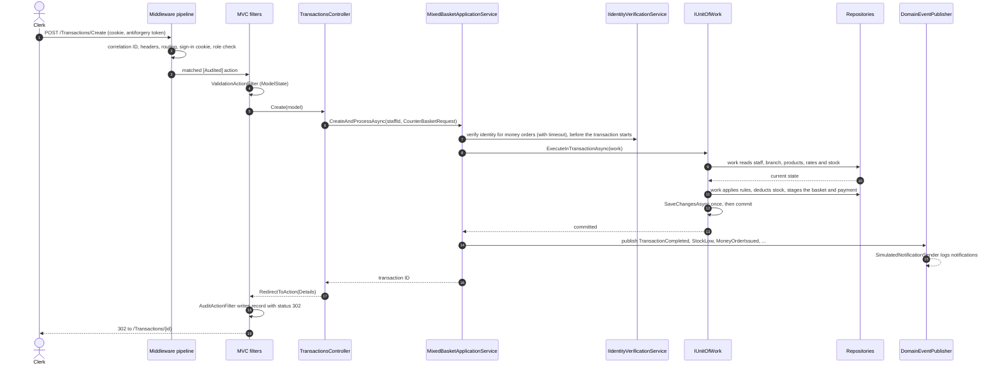

# Architecture and request flow

The layer, domain and pipeline diagrams, the middleware-versus-filter table and the threat model are in [DESIGN.md](../DESIGN.md). This page follows a single counter sale through the system.

## A counter sale, end to end

1. **Before MVC:** middleware establishes the correlation ID, security headers and identity. `[RequireApiKey]` and `[RequireAdminNetwork]` checks also happen here, though they don't apply to this endpoint.
2. **Validation:** filters run around the action. Invalid input is redisplayed before the action body runs.
3. **Slow external calls:** identity verification runs before the transaction starts, so a slow provider never holds up other sales.
4. **One atomic use case:** every rule check and state change for the sale happens inside one `IUnitOfWork.ExecuteInTransactionAsync` call, with one save. If anything fails, nothing is saved and no events are published. It runs on SQL Server through `SqlUnitOfWork` ([ADR 0020](adr/0020-repository-and-unit-of-work-boundaries.md)).
5. **After commit:** events are published only after the save. The audit record is written after the redirect result has executed, so it records the real 302.

## Data and security boundaries

- **Branch authority:** branch scope comes from the persisted staff record behind the authenticated `StaffId`. Branch codes in forms or cookie claims are never trusted for authority.
- **Unattributed legacy sales:** baskets with no branch attribution are not assigned to a branch and do not appear on branch pages.
- **Secrets:** API keys, passwords and credential hashes are not stored in business tables, sample files or audit records. Hashes have their own `StaffCredentials` table, and secrets come from user-secrets or the environment.
- **Audit sample:** `data/AUDIT-SAMPLE.json` holds real lines from the earlier JSON audit file, from a local run on seeded demo data. Runtime audit data is now in the `AuditEntries` table and should be protected as operational data.
- **Concurrency:** stock and transactions use rowversion with a bounded retry, so several application instances can share the database ([ADR 0021](adr/0021-concurrency-strategy.md)).
