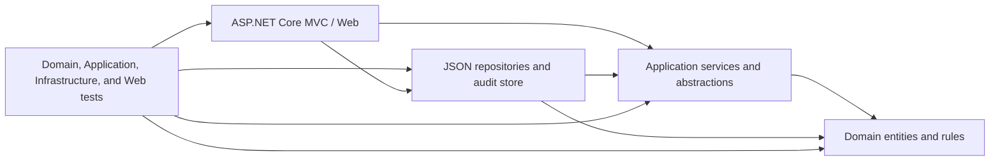
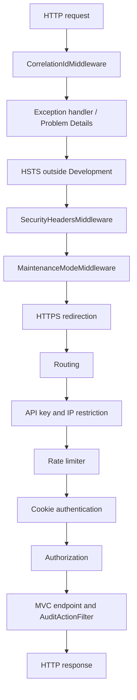

# Architecture and request flow

## Layered architecture

The Web project is the composition root. Application services use `IApexPostRepository`; Infrastructure implements the repository and reconstructs domain entities through validating constructors. The repository stores a versioned snapshot in `apexpost.json`, while audit events are appended as JSON Lines to a separate audit file. Staff credentials are separately provisioned and are not part of the business snapshot.

## HTTP middleware pipeline

Correlation is established before exception handling so error responses can include the same ID. Security headers wrap maintenance and downstream responses. Routing precedes endpoint-specific partner restrictions and rate-limit policy selection; authentication and authorization run before MVC actions.

## Data and security boundaries

- Branch scope is resolved from the persisted active staff record identified by the authenticated `StaffId`; browser-supplied branch codes do not establish authority.
- Transaction baskets with missing legacy branch attribution are not assigned automatically and are not available to branch-scoped pages.
- API keys and credential hashes are not stored in the business snapshot, sample files, or audit records.
- `AUDIT-SAMPLE.json` demonstrates the `AuditRecord` property shape only. Runtime audit data is append-only JSONL and must be protected as operational data.
- Demo snapshot initialization is opt-in and atomic with respect to calls sharing the singleton JSON repository instance. The repository lock does not coordinate multiple processes or separate repository instances.
