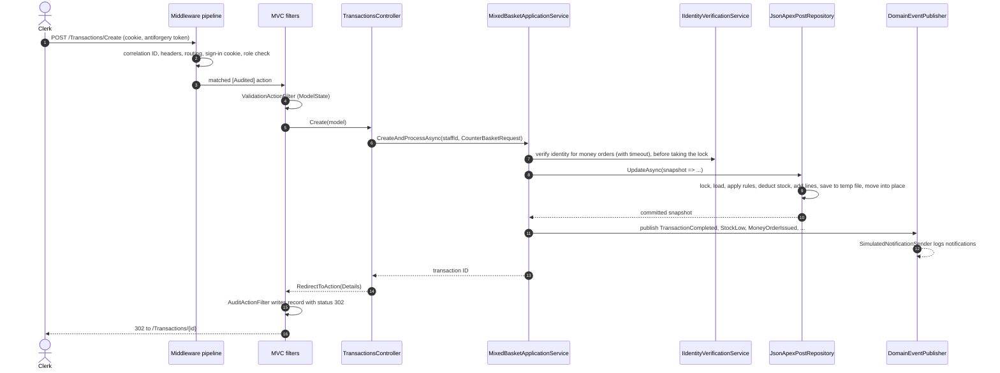

# Architecture and request flow

The layer, domain and pipeline diagrams, the middleware-versus-filter table and the threat model are in [DESIGN.md](../DESIGN.md). This page follows a single counter sale through the system.

## A counter sale, end to end

1. **Before MVC:** middleware establishes the correlation ID, security headers and identity. `[RequireApiKey]` and `[RequireAdminNetwork]` checks also happen here, though they don't apply to this endpoint.
2. **Validation:** filters run around the action. Invalid input is redisplayed before the action body runs.
3. **Slow external calls:** identity verification runs before the repository lock is taken, so a slow provider never holds up other sales.
4. **One atomic update:** every rule check and state change for the sale happens inside one `UpdateAsync` callback. If anything fails, nothing is saved and no events are published.
5. **After commit:** events are published only after the save. The audit record is written after the redirect result has executed, so it records the real 302.

## Data and security boundaries

- **Branch authority:** branch scope comes from the persisted staff record behind the authenticated `StaffId`. Branch codes in forms or cookie claims are never trusted for authority.
- **Unattributed legacy sales:** baskets with no branch attribution are not assigned to a branch and do not appear on branch pages.
- **Secrets:** API keys, passwords and credential hashes are not stored in the business snapshot, sample files or audit records. Credentials have their own file, and secrets come from user-secrets or the environment.
- **Audit sample:** `data/AUDIT-SAMPLE.json` holds real `audit-events.jsonl` lines from a local run on seeded demo data, exported unchanged as a JSON array. Runtime audit data is append-only JSON Lines and should be protected as operational data.
- **Single-process locking:** the repository lock coordinates one process only. Separate processes sharing a storage folder are not coordinated.
